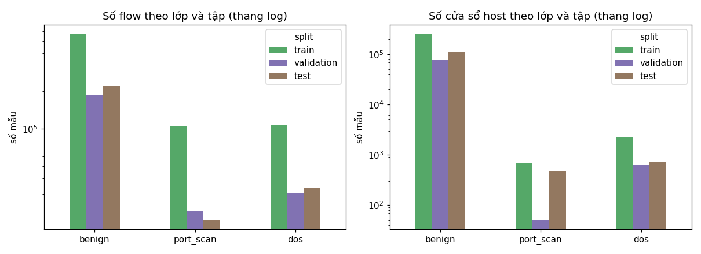
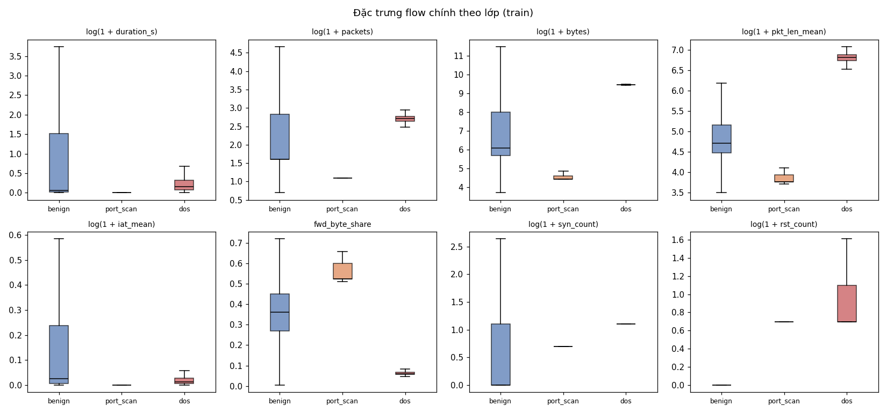
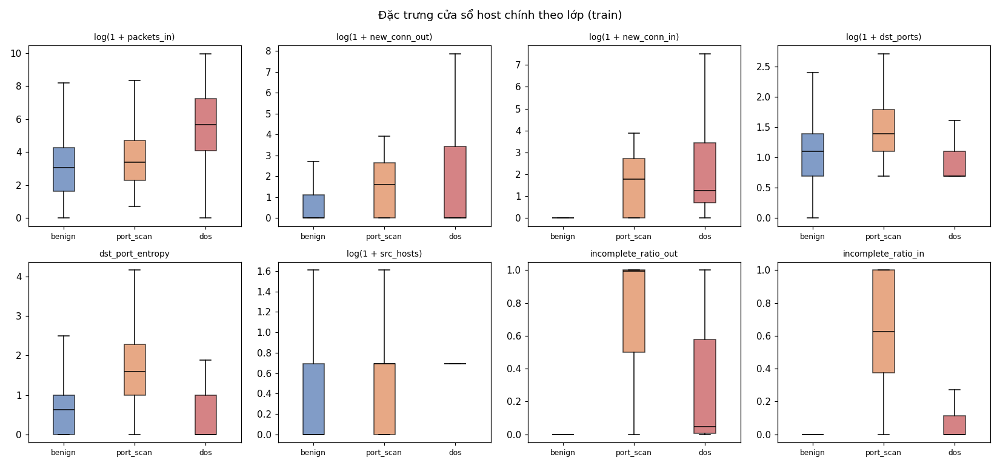
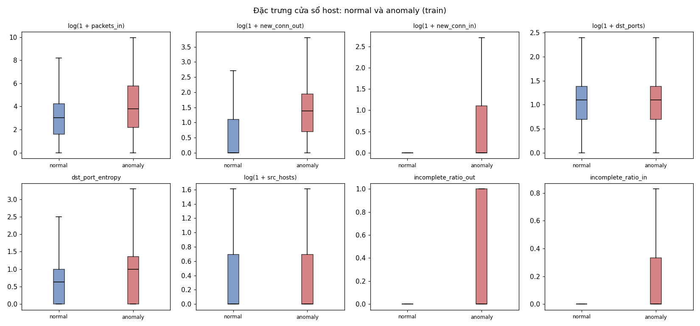
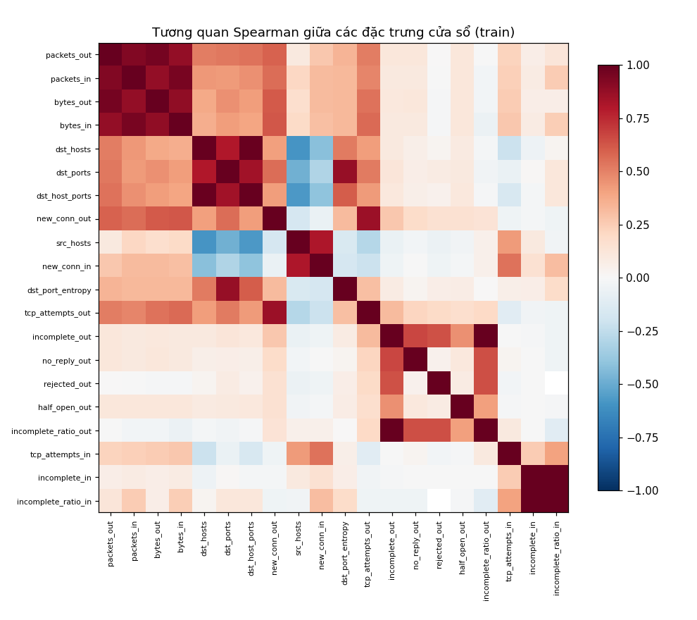
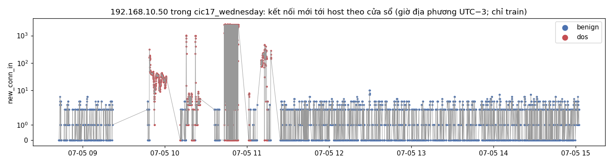

# C05-T06 — EDA cho các đặc trưng chính

Mã nguồn: `src/nids/eda.py`. Kiểm thử: `tests/test_eda.py`. Hình: `docs/hinh/`.

Cần matplotlib: `pip install -e ".[notebook]"`.

```bash
python -m nids.eda output/features/cic17_monday output/features/cic17_wednesday \
    output/features/cic17_friday --out docs/hinh
```

**Chống rò rỉ:** mọi hình đặc trưng chỉ vẽ trên **tập train**. Nếu nhìn phân bố của
validation hay test rồi dựa vào đó chọn đặc trưng, thông tin của các tập đó đã lọt vào
quyết định của mình. Ngoại lệ duy nhất là hình phân bố lớp, chỉ đếm nhãn.

Hộp trong các hình theo lớp: đường giữa là trung vị, hộp là 50% mẫu ở giữa, râu không vẽ
điểm ngoại lai. Đặc trưng đếm, byte, giây vẽ ở thang `log(1 + x)` vì lệch phải rất mạnh.

## 1. Phân bố lớp



Cả ba lớp có mặt ở cả ba tập, ở cả hai bảng. Ở bảng cửa sổ, `benign` nhiều hơn hai lớp tấn
công vài trăm lần (số liệu ở [30_kiem_tra_du_lieu.md](30_kiem_tra_du_lieu.md)).

## 2. Đặc trưng flow



Trung vị trên train:

| Đặc trưng | `benign` | `dos` | `port_scan` |
|---|---|---|---|
| `packets` (gói) | 4 | 14 | 2 |
| `bytes` | 436 | 12 674 | 84 |
| `pkt_len_mean` (byte) | 110 | 903 | 42 |
| `duration_s` (giây) | 0,061 | 0,164 | 0,00005 |
| `fwd_byte_share` | 0,36 | 0,06 | 0,52 |
| `rst_count` | 0 | 1 | 1 |

**Nhận xét:**
- Ba lớp tách nhau rõ ở `bytes` và `pkt_len_mean`. Nhưng **hộp của `dos` rất hẹp**: Hulk chiếm
  88,6% flow `dos` của train (95 698 / 108 004) và trả về trang gần như cùng kích thước (50%
  flow Hulk có 12 626–12 750 byte). Mô hình mức flow có nguy cơ học thuộc Hulk, không học
  được DoS nói chung. Slowloris và Slowhttptest chỉ có 4 032 và 2 990 flow.
- `fwd_byte_share` của `dos` rất thấp: gửi yêu cầu nhỏ, nhận về trang lớn. Đúng với DoS tầng
  HTTP. DoS SYN của lab sẽ có hình dạng khác hẳn, nên lớp `dos` phải có thêm mẫu từ lab
  (docs/06 mục 6).
- `port_scan` gần như một điểm duy nhất, khớp với kết quả 98,9% mẫu trùng ở C05-T05.

## 3. Đặc trưng cửa sổ host



Trung vị trên train:

| Đặc trưng | `benign` | `dos` | `port_scan` |
|---|---|---|---|
| `packets_in` | 20 | 284 | 28 |
| `new_conn_in` | 0 | 2,5 | 5 |
| `new_conn_out` | 0 | 0 | 4 |
| `dst_port_entropy` (bit) | 0,63 | 0 | 1,59 |
| `incomplete_ratio_out` | 0 | 0,05 | 0,99 |
| `incomplete_ratio_in` | 0 | 0 | 0,63 |

**Nhận xét:**
- `incomplete_ratio_out`, `incomplete_ratio_in` tách `port_scan` với hai lớp còn lại rất tốt. Ô
  trống của hai cột không được vẽ, nên hình chỉ nói về các cửa sổ có lần thử TCP.
- `packets_in` và `new_conn_in` tách `dos` với `benign`, nhưng các hộp vẫn chồng nhau: đợt
  slowloris chỉ có vài chục kết nối mới mỗi cửa sổ.
- Hai lớp tấn công chồng nhau khá nhiều trên từng đặc trưng, nên cần mô hình dùng nhiều đặc
  trưng cùng lúc.

**Mỗi lớp tấn công có hai "chân dung" đối lập.** Số cửa sổ gần bằng nhau giữa bên tấn công
và nạn nhân, vì nhãn tính cho cả hai đầu. Trung vị train:

| Lớp, host | Cửa sổ | `new_conn_out` | `new_conn_in` | `packets_out` | `packets_in` |
|---|---|---|---|---|---|
| `dos`, `172.16.0.1` (tấn công) | 1 137 | 29 | 2 | 322 | 92 |
| `dos`, `192.168.10.50` (nạn nhân) | 1 133 | 0 | 30 | 130 | 345 |
| `port_scan`, `172.16.0.1` (tấn công) | 338 | 10 | 0 | 22 | 12 |
| `port_scan`, `192.168.10.50` (nạn nhân) | 333 | 0 | 10 | 48 | 50 |

Hệ quả: hộp trong hình rộng vì gộp hai nhóm này. Mô hình tuyến tính (Logistic Regression) có
thể khó hơn Random Forest với dữ liệu hai cụm như vậy; Chặng 7 sẽ kiểm chứng, và nên báo cáo
kết quả tách theo vai.

Cột `new_conn_in` của `172.16.0.1` khác 0 vì `192.168.10.51` (và `.3`) chủ động gọi tới cổng
443 của nó (docs/26).

## 4. Normal và anomaly



Lớp `anomaly` gồm cả các đợt bị loại khỏi phân loại (DDoS, Heartbleed, bot). **58% cửa sổ
`anomaly` của train (5 226 / 8 963) là của 5 máy bot**, với rất ít gói (trung vị 8–53 gói
vào mỗi cửa sổ, so với 20 của `normal`). Hai phân bố chồng nhau nhiều ở hầu hết đặc trưng,
trừ `new_conn_in`, `incomplete_ratio_out`, `incomplete_ratio_in`.

Dự đoán cần kiểm chứng ở Chặng 6: Gaussian sẽ khó bắt các cửa sổ bot, vì chúng trông gần
như bình thường. Nên báo cáo Recall của module anomaly tách theo loại tấn công, không chỉ
một con số chung.

## 5. Tương quan giữa các đặc trưng cửa sổ



Các cặp có |r| ≥ 0,95 (Spearman, train):

| Cặp | r |
|---|---|
| `incomplete_in`, `incomplete_ratio_in` | 0,999 |
| `incomplete_out`, `incomplete_ratio_out` | 0,997 |
| `dst_hosts`, `dst_host_ports` | 0,986 |
| `packets_out`, `bytes_out` | 0,957 |
| `packets_in`, `bytes_in` | 0,951 |

**Hệ quả cho Chặng 6:** ma trận hiệp phương sai của Gaussian có thể gần suy biến. C06-T03 phải
xử lý: bỏ bớt một đặc trưng trong mỗi cặp hoặc cộng thêm một lượng nhỏ vào đường chéo. Tương
quan tính trên các cặp ô có giá trị; ô trống bị bỏ qua.

## 6. Một đợt tấn công theo thời gian



Web server `192.168.10.50` thứ Tư, chỉ các cửa sổ train. Các đợt DoS nổi rõ trên nền bình
thường: slowloris 09:47–10:01, Slowhttptest 10:14–10:26, Hulk 10:43–10:53, GoldenEye
11:10–11:17 (phần train của mỗi đợt, docs/29). Các khoảng trống là phần thời gian thuộc validation, test hoặc vùng đệm.

## 7. Kiểm thử

Kiểm thử tự động (1 ca, bỏ qua nếu máy chưa cài matplotlib): chạy toàn bộ trên phiên giả lập,
mọi file hình được tạo và có nội dung. Nội dung hình do người đọc và đối chiếu với số liệu.

## Thuật ngữ

Giải thích ngắn các thuật ngữ dùng trong tài liệu này.

| Thuật ngữ | Giải thích |
|---|---|
| EDA | Khảo sát dữ liệu bằng thống kê và biểu đồ trước khi huấn luyện |
| Trung vị | Giá trị đứng giữa khi xếp các mẫu theo thứ tự |
| Biểu đồ hộp | Hộp là 50% mẫu ở giữa, đường trong hộp là trung vị |
| Điểm ngoại lai | Mẫu nằm rất xa phần lớn mẫu còn lại |
| Thang log | Trục giãn theo lũy thừa, để thấy được cả số rất nhỏ và rất lớn |
| Lệch phải | Đa số giá trị nhỏ, một ít giá trị rất lớn |
| Tương quan Spearman | Mức hai đặc trưng cùng tăng giảm theo thứ hạng, từ −1 đến 1 |
| Hiệp phương sai, suy biến | Bảng đo các đặc trưng biến thiên cùng nhau; suy biến khi có đặc trưng gần như trùng thông tin, làm phép tính của Gaussian mất ổn định |
| Chân dung | Hình dạng đặc trưng điển hình của một nhóm mẫu |
| Mô hình tuyến tính | Mô hình phân chia dữ liệu bằng tổng có trọng số của các đặc trưng |
