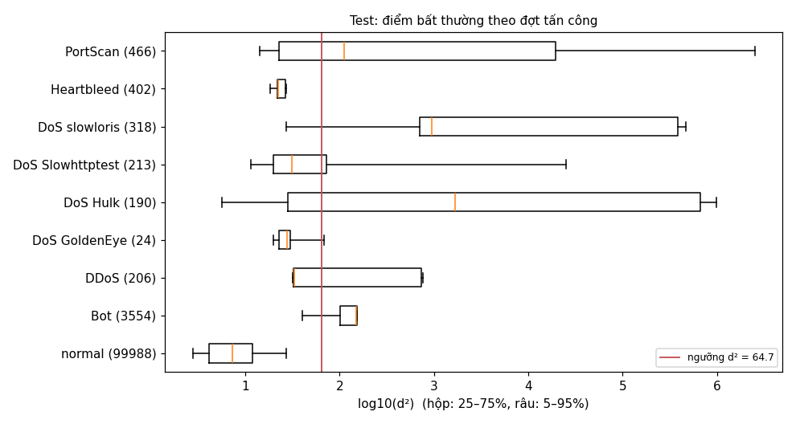

# C06-T05 — Đánh giá Precision, Recall, F1 và tỷ lệ báo động giả

Mã nguồn: `evaluate`, `alert_episodes`, `assumption_checks` trong `src/nids/gaussian.py`. Kiểm
thử: `tests/test_gaussian.py`.

```bash
cd src
python -m nids.gaussian danh-gia ../output/features/cic17_monday ../output/features/cic17_wednesday \
    ../output/features/cic17_friday --out ../docs/hinh --so-sanh
```

Lệnh ghi `docs/hinh/gauss_test.json` và `gauss_test_theo_dot.png`. Mô hình và ngưỡng là của
C06-T04 (fit trên normal của train cả ba ngày, ngưỡng d² = 64,65, chọn trên validation); test
chỉ được dùng ở bước này. Có `--model` thì dùng mô hình đã lưu (C06-T06).

## 1. Kết quả trên test

Test: 105 361 cửa sổ host của cả ba ngày, trong đó 5 373 `anomaly` (5,1%).

| Chỉ số | Test | Validation (để so) |
|---|---|---|
| Precision | **0,733** | 0,671 |
| Recall | **0,727** | 0,733 |
| F1 | **0,730** | 0,700 |
| Tỷ lệ báo động giả (FPR) | **1,42%** | 1,49% |
| AUC | 0,977 | — |
| AP (diện tích dưới đường Precision–Recall) | 0,736 | — |

Bảng nhầm lẫn: 3 906 cửa sổ tấn công bị báo đúng, 1 467 bị bỏ sót, 1 420 cửa sổ bình thường bị
báo nhầm, 98 568 cửa sổ bình thường không báo.

Kết quả test gần với validation, nên ngưỡng chọn trên validation dùng được trên dữ liệu chưa thấy
(cùng mạng, cùng đợt tấn công; xem mục 4).

### Theo phiên

| Phiên | Cửa sổ | Anomaly | Precision | Recall | F1 | FPR | Đợt báo động giả / giờ |
|---|---|---|---|---|---|---|---|
| Thứ Hai (không tấn công) | 32 275 | 0 | — | — | — | 1,28% | 42,1 |
| Thứ Tư (DoS, Heartbleed) | 31 440 | 1 147 | 0,453 | 0,424 | 0,438 | 1,94% | 12,4 |
| Thứ Sáu (bot, quét, DDoS) | 41 646 | 4 226 | 0,891 | 0,809 | 0,848 | 1,12% | 16,6 |

**Đợt báo động** là các cửa sổ bị báo liên tiếp của cùng một host (cách nhau ≤ 10 giây) gộp lại,
vì cửa sổ trượt 2 giây nên một sự kiện làm khoảng 5 cửa sổ liền nhau bị báo. Tính trên toàn mạng
khoảng 15–17 host. Thứ Hai cao vì phần test chỉ dài 1,76 giờ cuối ngày, lúc có vài host hoạt
động khác thường; ba ngày cộng lại có 248 đợt báo nhầm trong 14,2 giờ, khoảng **17 đợt mỗi
giờ**.

### Theo đợt tấn công



| Đợt | Cửa sổ test | Recall test | Recall validation |
|---|---|---|---|
| DoS slowloris | 318 | 0,912 | 1,000 |
| Bot | 3 554 | 0,863 | 0,840 |
| DoS Hulk | 190 | 0,705 | 0,750 |
| PortScan | 466 | 0,537 | 0,680 |
| DDoS | 206 | 0,495 | 0,500 |
| DoS Slowhttptest | 213 | 0,277 | 0,281 |
| DoS GoldenEye | 24 | 0,125 | 0,936 |
| Heartbleed | 402 | **0,000** | 0,000 |

- **Bắt tốt:** slowloris (nhiều kết nối dở dang), bot, Hulk (rất nhiều gói, kết nối).
- **PortScan 0,54:** phía nạn nhân và các lượt quét mạnh bị bắt; phía bên tấn công `172.16.0.1`
  là địa chỉ NAT, gom nhiều máy, nên các lượt quét nhẹ lẫn vào lưu lượng bình thường của nó.
- **DDoS 0,50:** đúng bằng phần nạn nhân; phía bên tấn công (NAT) d² chỉ khoảng 31.
- **GoldenEye 0,13 trên test, 0,94 trên validation:** test chỉ có 24 cửa sổ, ở đoạn cuối khi tấn
  công đã yếu dần. Số mẫu quá ít để kết luận.
- **Heartbleed 0:** xem mục 3.

## 2. Thứ Tư khó hơn thứ Sáu

F1 thứ Tư chỉ 0,44 so với 0,85 thứ Sáu. Thứ Tư có:
- Heartbleed (402 cửa sổ test) không bắt được: riêng phần này đã kéo Recall thứ Tư xuống;
- các DoS "chậm" (Slowhttptest) khó phân biệt trong cửa sổ 10 giây;
- nhiều báo động giả hơn (FPR 1,94%), chủ yếu từ máy `192.168.10.8` (174 cửa sổ).

## 3. Hạn chế của giả định Gaussian

Mô hình giả định: sau biến đổi, cửa sổ bình thường theo **một** phân bố Gaussian đa biến. Các số
liệu dưới đây cho thấy giả định này sai ở đâu và cái giá phải trả.

### 3.1. Đuôi dày: không dùng được ngưỡng lý thuyết

Nếu đúng Gaussian, d² theo χ²(14) và ngưỡng χ² 99% chỉ báo nhầm 1%. Thực tế trên test:

| Ngưỡng | Precision | Recall | F1 | FPR |
|---|---|---|---|---|
| χ² 99% (d² = 29,1) | 0,515 | 0,841 | 0,638 | **4,26%** |
| χ² 99,9% (d² = 36,1) | 0,610 | 0,800 | 0,692 | **2,75%** |
| Chọn trên validation (d² = 64,7) | 0,733 | 0,727 | 0,730 | 1,42% |

Báo động giả gấp 4 tới 27 lần mức lý thuyết. **Ngưỡng bắt buộc phải chọn bằng dữ liệu**, nên mô
hình cần một tập validation có nhãn; không thể chỉ "học bình thường rồi đặt ngưỡng 99%".

### 3.2. Cột gần như toàn 0

Năm cột về kết nối không hoàn tất có ≥ 95% giá trị 0 (C06-T02). Không phép biến đổi nào biến
chúng thành dạng chuông. Hệ quả:
- **Báo động giả đến từ chính các cột này:** trên các cửa sổ bình thường bị báo nhầm, độ lệch
  chuẩn hóa trung bình lớn nhất là ở `half_open_out` (5,7), `no_reply_out` (4,3), `rejected_out`
  (3,0). Một máy bình thường thỉnh thoảng gọi một dịch vụ không trả lời cũng đủ bị báo.
- Nhưng đây cũng là tín hiệu quét cổng mạnh nhất, nên không bỏ được.

### 3.3. Hành vi bình thường có nhiều "kiểu": một Gaussian không đủ

Mạng có nhiều kiểu host: máy rảnh, máy duyệt web, máy chủ DNS, máy in. Một Gaussian chỉ có một
đỉnh, nên phải "phình to" để phủ mọi kiểu, và các tấn công nằm giữa các kiểu lọt qua. So sánh
(cùng biến đổi, cùng mẫu fit, ngưỡng chọn cùng cách trên validation):

| Mô hình | F1 validation | Precision test | Recall test | F1 test | FPR test | AUC test | AP test |
|---|---|---|---|---|---|---|---|
| Gaussian bỏ tương quan (đường chéo) | 0,685 | 0,735 | 0,695 | 0,714 | 1,35% | 0,925 | 0,682 |
| **Gaussian đầy đủ (mô hình chính)** | 0,700 | 0,733 | 0,727 | 0,730 | 1,42% | 0,977 | 0,736 |
| Hỗn hợp 8 Gaussian | 0,742 | 0,901 | 0,684 | 0,777 | 0,41% | 0,978 | 0,829 |

- **Tương quan giữa các cột có ích:** bỏ đi thì AUC giảm từ 0,977 xuống 0,925. Gaussian đa biến
  đầy đủ đúng là lựa chọn tốt hơn mô hình các cột độc lập.
- **Bỏ giả định "một đỉnh" giúp nhiều:** hỗn hợp 8 Gaussian giảm báo động giả từ 1,42% xuống
  0,41% với Recall gần như cũ, AP tăng từ 0,74 lên 0,83. Đây là bằng chứng rõ nhất rằng giả định
  một Gaussian là giới hạn chính. Hỗn hợp Gaussian là hướng cải tiến cho Chặng 7; mô hình chính
  của Chặng 6 vẫn là Gaussian đơn như kế hoạch.

### 3.4. Tấn công trông bình thường

Gaussian chỉ thấy **lượng** lưu lượng (số gói, số kết nối, số cổng), không thấy **nội dung**:
- **Heartbleed** là một kết nối TLS bình thường về hình dạng: recall 0, d² chỉ 15–27, thấp hơn
  nhiều cửa sổ bình thường.
- **Phía bên tấn công sau NAT** (DDoS, PortScan): một địa chỉ gom lưu lượng của nhiều máy, nên
  "bình thường" của địa chỉ đó đã rất ồn.
- **DoS chậm** (Slowhttptest): mỗi cửa sổ 10 giây chỉ có ít gói.

Đây là giới hạn của mọi cách phát hiện bất thường dựa trên thống kê lưu lượng, không riêng
Gaussian; cần đặc trưng nội dung hoặc chữ ký để bắt các loại này.

### 3.5. Ngưỡng nhạy với các cụm điểm

Cụm cửa sổ bot có d² tụ quanh 100–150. Ngưỡng F1 lớn nhất trên validation nằm sát mép cụm này
(C06-T04 mục 3); chỉ cần lệch nhẹ là mất gần hết bot. Phải dùng ngưỡng "F1 ổn định", đổi lại báo
động giả cao hơn (1,42% thay vì khoảng 0,6%).

## 4. Giới hạn của việc đánh giá

- Train, validation, test cùng một mạng và cùng các đợt tấn công, chỉ khác thời điểm (docs/29).
  Kết quả trên mạng khác (lab) có thể thấp hơn.
- Một số đợt có rất ít cửa sổ test (GoldenEye 24, PortScan validation 50): recall theo đợt của
  chúng dao động lớn.
- Nhãn cửa sổ có nhiễu: cửa sổ chứa ít flow tấn công là `mo_ho` và bị bỏ; cửa sổ của host bot cả
  ngày đều là `anomaly`, kể cả lúc bot im lặng.

## 5. Kiểm thử

Kiểm thử tự động (3 ca): đếm đợt báo động (gộp cửa sổ liền nhau theo host); đánh giá trên dữ liệu
tổng hợp có hai phiên (Recall, FPR, kết quả theo phiên, so với ngưỡng χ²); so sánh ba biến thể mô
hình chạy được và cho AUC hợp lý.

## Thuật ngữ

Giải thích ngắn các thuật ngữ dùng trong tài liệu này.

| Thuật ngữ | Giải thích |
|---|---|
| Precision | Trong các cửa sổ bị báo động, tỷ lệ đúng là tấn công |
| Recall | Trong các cửa sổ tấn công thật, tỷ lệ bị báo động |
| F1 | Trung bình điều hòa của Precision và Recall |
| FPR (tỷ lệ báo động giả) | Tỷ lệ cửa sổ bình thường bị báo nhầm |
| Bảng nhầm lẫn | Bảng đếm bốn trường hợp: báo đúng, bỏ sót, báo nhầm, không báo đúng |
| AUC | Xác suất một cửa sổ tấn công có điểm cao hơn một cửa sổ bình thường ngẫu nhiên |
| AP | Diện tích dưới đường Precision–Recall; nhạy với lớp hiếm |
| Đợt báo động | Các cửa sổ bị báo liên tiếp của cùng host, gộp làm một |
| χ² (chi bình phương) | Phân bố lý thuyết của d² nếu dữ liệu đúng Gaussian |
| Đuôi dày | Có nhiều giá trị cực lớn hơn phân bố chuẩn dự đoán |
| Gaussian đường chéo | Gaussian coi các cột độc lập, bỏ tương quan |
| Hỗn hợp Gaussian | Mô hình gồm nhiều Gaussian, mỗi cái mô tả một "kiểu" hành vi |
| NAT | Thiết bị thay địa chỉ của nhiều máy bằng một địa chỉ chung |
| DoS chậm | Tấn công giữ kết nối mở rất lâu với rất ít dữ liệu, làm cạn tài nguyên máy chủ |
