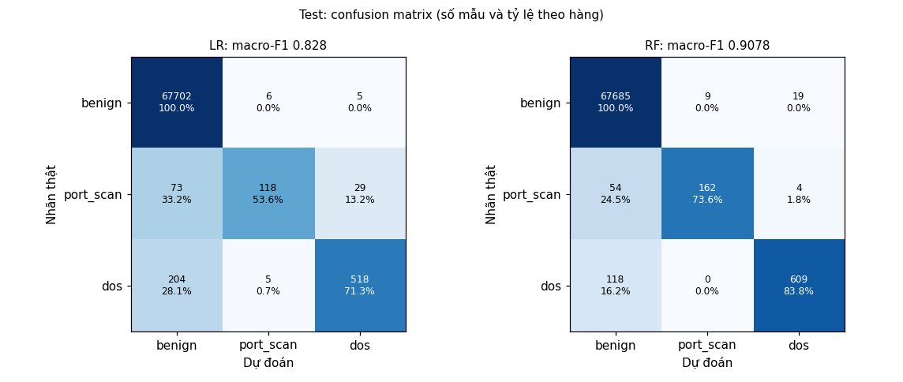

# C07-T05 — Đánh giá macro-F1, chỉ số từng lớp và confusion matrix

Mã nguồn: `evaluate`, `refit_chosen`, `bootstrap_ci`, `duplicate_mask`, `class_groups`,
`plot_confusions` trong `src/nids/classifier.py`. Kiểm thử: `tests/test_classifier.py`. Kết quả:
`docs/hinh/phan_loai_test.json`, `docs/hinh/phan_loai_confusion.png`.

```bash
cd src
python -m nids.classifier danh-gia ../output/features/cic17_wednesday ../output/features/cic17_friday \
    --chon ../docs/hinh/phan_loai_chon.json --out ../docs/hinh
```

Lệnh fit lại đúng cấu hình đã chọn ở C07-T04 trên train (seed cố định) rồi đo trên test. Đây là
**lần đầu đọc tập test** của Chặng 7; không có tham số nào được chỉnh sau khi xem kết quả dưới đây.

## 1. Bảng so sánh hai mô hình (cùng bài toán, cùng test)

Test: 68 902 cửa sổ (benign 67 713, dos 727, port_scan 462), thứ Tư và thứ Sáu.

| | Logistic Regression | Random Forest |
|---|---|---|
| Tham số (chọn trên validation) | C = 1, không cân bằng | 300 cây, `max_depth` 20, `min_samples_leaf` 3, sqrt, không cân bằng |
| Macro-F1 validation | 0,883 | 0,913 |
| **Macro-F1 test** | **0,766** | **0,831** |
| Khoảng 95% (bootstrap) | 0,747–0,784 | 0,815–0,846 |
| Accuracy test | 0,992 | 0,994 |
| benign: P / R / F1 | 0,993 / 0,9995 / 0,996 | 0,994 / 0,9997 / 0,997 |
| port_scan: P / R / F1 | 0,923 / 0,336 / 0,492 | 0,967 / 0,448 / 0,612 |
| dos: P / R / F1 | 0,901 / 0,737 / 0,811 | 0,969 / 0,813 / 0,884 |
| Benign bị báo tấn công | 32 (0,047%) | 21 (0,031%) |
| Đợt báo nhầm mỗi giờ (thứ Tư / thứ Sáu) | 0,8 / 1,5 | 0,5 / 0,4 |

**Bootstrap ghép cặp trên test**: RF hơn LR ở 100% trong 1 000 lần lấy lại; hiệu +0,065, khoảng
95% [+0,051; +0,079]. Kết luận của C07-T04 (chọn RF) đứng vững trên test, và chênh lệch còn lớn hơn
trên validation.

Confusion matrix (hàng: nhãn thật, cột: dự đoán):

| LR | benign | port_scan | dos | | RF | benign | port_scan | dos |
|---|---|---|---|---|---|---|---|---|
| benign | 67 681 | 12 | 20 | | benign | 67 692 | 7 | 14 |
| port_scan | 268 | 155 | 39 | | port_scan | 250 | 207 | 5 |
| dos | 190 | 1 | 536 | | dos | 136 | 0 | 591 |



Lỗi gần như chỉ có một kiểu: **tấn công bị đoán là benign** (bỏ sót). Báo nhầm rất ít: RF báo
nhầm 21 trên 67 713 cửa sổ benign, khoảng 0,4–0,5 đợt mỗi giờ trên toàn mạng, so với khoảng 17 đợt
mỗi giờ của Gaussian (Chặng 6). Precision của hai lớp tấn công đều trên 0,96.

## 2. Theo phiên và theo đợt tấn công (RF)

Mỗi phiên chỉ có một lớp tấn công, nên macro-F1 theo phiên tính trên các lớp có mặt: thứ Tư 0,944
(benign, dos), thứ Sáu 0,808 (benign, port_scan). LR: 0,918 và 0,747.

| Đợt | Lớp | Số cửa sổ test | Recall LR | Recall RF | RF đoán sai thành |
|---|---|---|---|---|---|
| DoS slowloris | dos | 318 | 0,940 | **0,956** | benign 14 |
| DoS Hulk | dos | 190 | 0,742 | 0,805 | benign 37 |
| DoS GoldenEye | dos | 24 | 0,292 | 0,667 | benign 8 |
| DoS Slowhttptest | dos | 195 | 0,456 | 0,605 | benign 77 |
| PortScan | port_scan | 462 | 0,336 | 0,448 | benign 250, dos 5 |

Theo vai trò host (recall tấn công, RF): bên tấn công 0,703, nạn nhân 0,640. LR: 0,642 và 0,521.

## 3. Vì sao recall port_scan thấp: phần lớn cửa sổ "quét" gần như không có traffic quét

Recall port_scan giảm từ 0,68 (validation) xuống 0,45 (test). Tách theo số lần thử kết nối TCP
trong cửa sổ:

| Port_scan, RF | Cửa sổ có ≥ 20 lần thử TCP (vào hoặc ra) | Cửa sổ có < 20 lần thử TCP |
|---|---|---|
| Validation | 34 cửa sổ, recall **1,00** | 16 cửa sổ, recall 0,00 |
| Test | 180 cửa sổ, recall **0,978** | 282 cửa sổ, recall 0,11 |

Cửa sổ bị bỏ sót có trung vị **13 flow và 0 lần thử TCP**, so với khoảng 1 000 lần thử ở cửa sổ đoán
đúng. Chúng nằm trong khung giờ quét và có flow giữa đúng cặp IP tấn công–nạn nhân, nên được gán
`port_scan` (docs/28), nhưng trong 10 giây đó gần như không có hoạt động quét. Phần test của đợt
quét rơi vào đoạn có nhiều khoảng nghỉ giữa các lượt Nmap hơn phần validation, nên recall giảm.

Như vậy: **khi thật sự có quét, RF bắt được gần như hết**; con số 0,45 phần lớn phản ánh cách gán
nhãn cửa sổ (QĐ-026: chỉ cần 20% flow là tấn công). C07-T06 xem các flow trong những cửa sổ này là
gì (ICMP, UDP hay kiểu quét không gửi SYN). Không đổi nhãn sau khi xem test: việc sửa định nghĩa nhãn
phải làm lại từ Chặng 5 và chọn lại trên validation.

DoS bỏ sót tập trung ở **Slowhttptest** (77/195) và **Hulk** (37/190): các công cụ DoS chậm giữ ít
kết nối, gửi ít gói, nên nhiều cửa sổ trông như một client web bình thường.

## 4. Mẫu test trùng train

26 023 cửa sổ test có vector đặc trưng trùng hệt một cửa sổ train, gần như toàn bộ là benign
(26 013; chủ yếu cửa sổ nhàn rỗi), chỉ 9 dos và 1 port_scan. Bỏ chúng đi, macro-F1 RF là 0,834
(LR 0,768), gần như không đổi: kết quả **không** đến từ việc thuộc lòng mẫu trùng (khác bảng flow,
docs/30 mục 5).

## 5. Hạn chế

- Khoảng 95% bootstrap coi các cửa sổ là độc lập; cửa sổ liền nhau có tương quan nên khoảng thật
  rộng hơn.
- GoldenEye chỉ 24 cửa sổ: recall 0,67 là 16/24, sai số lớn.
- Train và test cùng một nguồn tấn công, cùng một nạn nhân, cùng ngày; chưa đo với công cụ hay mạng
  khác (dữ liệu lab, Chặng 11).
- DoS kiểu SYN chưa có trong dữ liệu (docs/39 mục 4).

## 6. Kiểm thử

- Số mẫu tổng và theo phiên khớp tập test; có recall theo đợt và khoảng tin cậy.
- Cấu hình fit lại đúng là cấu hình đã chọn trên validation.
- `duplicate_mask` coi ô trống như nhau khi so vector; `bootstrap_ci` cho [1, 1] khi đoán đúng hết.
- Đợt tấn công của một cửa sổ chỉ tìm trong các đợt cùng lớp (sửa ở bước này: trước đó một cửa sổ
  có thể bị gán vào đợt của lớp khác hoặc đợt bị loại nếu lịch trùng giờ).

## Cập nhật 07/11/2026 — chia port_scan theo lượt Nmap (QĐ-060)

Sau báo cáo này, port_scan được chia theo giao thức quét thay vì thuần thời gian (QĐ-060, docs/44), rồi
**chọn lại mô hình trên validation mới và đọc test một lần**. Bảng kết quả ở `docs/hinh/phan_loai_test.json`
đã cập nhật theo bản này:

| | RF cũ (chia theo thời gian) | RF mới (chia theo lượt Nmap) |
|---|---|---|
| Macro-F1 test | 0,831 | **0,908** |
| port_scan P / R / F1 | 0,967 / 0,448 / 0,612 | 0,947 / **0,736** / **0,829** |
| trong đó SCTP / UDP / TCP (recall) | 0,02 / 0,01 / 0,83 | **0,84** / 0,14 / 0,83 |
| dos R | 0,813 | 0,838 |
| benign bị báo | thấp | 0,04% |

Kết luận cũ (chọn RF) không đổi. Quét UDP cải thiện ít vì tín hiệu mỗi cửa sổ 10 giây vốn yếu; cửa sổ dài
hơn là hướng về sau.

## Thuật ngữ

Giải thích ngắn các thuật ngữ dùng trong tài liệu này.

| Thuật ngữ | Giải thích |
|---|---|
| Macro-F1 | Trung bình F1 ba lớp, mỗi lớp nặng như nhau |
| Precision, Recall, F1 | Tỷ lệ báo đúng; tỷ lệ bắt được; trung bình điều hòa của hai số |
| Confusion matrix | Bảng đếm mẫu theo nhãn thật (hàng) và nhãn dự đoán (cột) |
| Bootstrap, khoảng 95% | Lấy lại mẫu có hoàn lại nhiều lần; khoảng chứa 95% kết quả |
| Bỏ sót, báo nhầm | Tấn công bị đoán là benign; benign bị đoán là tấn công |
| Đợt báo nhầm | Các cửa sổ báo nhầm liên tiếp của cùng host gộp làm một |
| Lần thử TCP | Gói SYN mở kết nối TCP (docs/24) |
| Slowloris, Slowhttptest, Hulk, GoldenEye | Bốn công cụ DoS tầng HTTP trong CIC-IDS2017 |
| Nmap, lượt quét | Công cụ quét cổng; một lần chạy Nmap |
| Thuộc lòng | Đoán đúng vì đã thấy đúng mẫu đó trong train |
