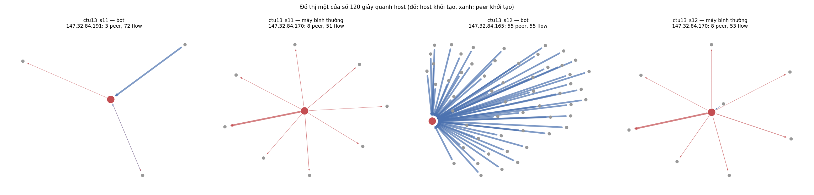

# C08-T01 — Đồ thị theo cửa sổ: node, cạnh, trọng số

Mã nguồn: `src/nids/ctu13.py` (đọc CTU-13), `window_edges`, `host_ports`, `to_graph` trong
`src/nids/graph_features.py`. Kiểm thử: `tests/test_botnet.py`. Kết quả:
`docs/hinh/botnet_do_thi.json`, `docs/hinh/botnet_do_thi.png`.

```bash
# 1. Đếm nhãn, giữ flow của host cần xét (mỗi scenario một file nén trong output/ctu13/)
python -m nids.ctu13 chuan-bi data/ctu13 --out output/ctu13
# 2. Dựng đồ thị, thống kê, vẽ ví dụ
cd src
python -m nids.graph_features do-thi ../output/ctu13 --scenario 11 --scenario 12 --out ../docs/hinh
```

## 1. Từ `.binetflow` đến bảng flow chung

`nids.ctu13` đọc file theo từng khúc 400 000 dòng và đổi sang **bảng flow chung** (`FLOW_COLUMNS`):

| Cột | Từ CTU-13 | Từ flow của dự án (CIC, lab) |
|---|---|---|
| `ts`, `end_ts` | `StartTime`, `StartTime + Dur` | `first_ts`, `last_ts` |
| `src`, `sport` → `dst`, `dport` | `SrcAddr`, `Sport` → `DstAddr`, `Dport` (Argus: nguồn là bên khởi tạo) | `fwd_ip`, `fwd_port` → `bwd_ip`, `bwd_port` |
| `proto` | `Proto` | `protocol` (6 → tcp, 17 → udp, 1 → icmp) |
| `packets`, `bytes`, `src_bytes`, `dst_bytes` | `TotPkts`, `TotBytes`, `SrcBytes`, `TotBytes − SrcBytes` | `packets`, `bytes`, `fwd_bytes`, `bwd_bytes` |
| `label` | `Label` | nhãn của lịch (nếu có) |

Nhờ vậy đồ thị và đặc trưng ở Chặng 8 dùng chung cho CTU-13 và dữ liệu lab (B12). Cổng ICMP của
Argus ghi dạng `0x0303` được đọc như số hex. `StartTime` là giờ địa phương Praha; chỉ dùng khoảng
cách thời gian trong cùng scenario nên không cần đổi múi giờ.

Hai lượt đọc mỗi file:
1. **Đếm**: nhóm nhãn, flow kênh điều khiển (`CC`), bot (nguồn của flow `From-Botnet`), máy bình
   thường (nguồn của `From-Normal`), số flow Background mỗi host nội bộ khởi tạo.
2. **Giữ lại** mọi flow có một đầu là **host cần xét** (QĐ-036):
   - bot trong mạng trường (`147.32.x`);
   - máy bình thường đã xác nhận (bỏ ba máy chủ "kém tin cậy" theo README);
   - 20 host nội bộ chỉ có nhãn Background, lấy mẫu ngẫu nhiên, khởi tạo ≥ 20 flow (seed cố định).

Scenario 12 (P2P) có 6 IP **bên ngoài** mang nhãn `From-Botnet`: đó là peer ở xa khởi tạo kết nối
tới bot. Chúng được ghi riêng (`peer_bot_ben_ngoai`) và chỉ là peer trong đồ thị, không là host
được chấm điểm.

Hai scenario đầu tiên đã chạy:

| Scenario | Flow gốc | Giờ | Bot | Máy bình thường | Flow `CC` | Flow giữ lại |
|---|---|---|---|---|---|---|
| 11 (Rbot, DDoS) | 107 251 | 0,27 | .165, .191, .192 | .134, .164, .170 | 2 | 17 058 |
| 12 (NSIS.ay, P2P) | 325 471 | 1,72 | .165, .191, .192 | .134, .164, .170 | 25 | 25 975 |

Chỉ giữ 5–16% số flow, nên cả 13 scenario vừa RAM. Số liệu đủ 13 scenario ở C08-T04 (sau khi tải
xong).

## 2. Đồ thị theo cửa sổ

| Thành phần | Định nghĩa |
|---|---|
| Cửa sổ | 120 giây, bước 10 giây (`windows.graph`, B02); `window_start` là bội của 10 giây |
| Flow thuộc cửa sổ | Mọi cửa sổ chứa **thời điểm bắt đầu** của flow (mỗi flow thuộc 12 cửa sổ) |
| Node | Địa chỉ IP |
| Cạnh | Có hướng, từ bên khởi tạo flow sang bên kia |
| Trọng số cạnh | `so_flow`, `so_goi`, `so_byte`, `so_cong` (số cổng đích khác nhau), `so_flow_udp`, `so_flow_khong_tra_loi` (bên kia không gửi byte nào) |

Bảng cạnh lưu **từ phía từng host cần xét**: mỗi dòng là `(cửa sổ, host, peer, hướng)`, hướng `ra`
nếu host khởi tạo, `vao` nếu peer khởi tạo. Đây là đồ thị một bước quanh host. `to_graph` ghép các
dòng của một cửa sổ thành đồ thị có hướng của networkx; cạnh giữa hai host cùng được xét chỉ tính
một lần.

Cách tính tiết kiệm bộ nhớ: gộp flow theo ô 10 giây và theo `(host, peer, hướng, cổng)` trước, rồi
mới trải mỗi ô ra 12 cửa sổ. Một bot DDoS gửi hàng nghìn flow giống nhau trong 10 giây chỉ còn một
dòng. Số cổng đích của cả host (`host_ports`) tính riêng vì không cộng được qua các peer.

## 3. Kết quả

| Scenario | Số cạnh | Số host–cửa sổ | Peer mỗi host–cửa sổ (trung vị / 90% / 99%) | Thời gian chạy |
|---|---|---|---|---|
| 11 | 1 871 | 381 | 3 / 10 / 18 | dưới 7 giây cho cả hai |
| 12 | 82 333 | 2 233 | 22 / 69 / 282 | |



Ở cửa sổ có lưu lượng trung vị:
- **Bot P2P** (scenario 12, `.165`) nhận kết nối từ 55 peer, mỗi peer một flow, phần lớn do peer
  ở xa khởi tạo.
- **Bot Rbot** (scenario 11, `.191`) chỉ có 3 peer, một peer gửi dồn nhiều flow.
- **Máy bình thường** (`.170`) chủ động gọi tới khoảng 8 đích, có một đích chiếm phần lớn.

Các khác biệt này là cơ sở cho đặc trưng ở C08-T02 (số peer, tương hỗ, mức tập trung) và C08-T03
(beaconing).

## 4. Hạn chế

- Chỉ thấy **hàng xóm trực tiếp** của host cần xét; không biết peer đó nói chuyện với ai khác (cần đồ
  thị toàn mạng, quá lớn với CTU-13).
- Flow dài (ví dụ kết nối IRC giữ hàng giờ) chỉ tính ở các cửa sổ chứa lúc bắt đầu.
- 20 host Background là mẫu, không phải toàn bộ mạng trường.

## 5. Kiểm thử

- Nhãn CTU-13 quy về đúng năm nhóm; nhận flow kênh điều khiển `CC`.
- Đọc file `.binetflow` mẫu: đếm bot, máy bình thường, Background nội bộ; cổng ICMP hex; byte chiều về;
  giữ đúng flow của host xét; peer ngoài không thành host xét.
- Lấy mẫu Background bỏ host đã loại và host ít flow; cùng seed cùng kết quả.
- Một flow nằm đúng trong 12 cửa sổ; trọng số, số cổng, flow không trả lời, hướng; cạnh giữa hai host
  xét chỉ tính một lần; cửa sổ không là bội của bước thì báo lỗi.

## Thuật ngữ

Giải thích ngắn các thuật ngữ dùng trong tài liệu này.

| Thuật ngữ | Giải thích |
|---|---|
| Đồ thị giao tiếp | Hình gồm các máy (node) và đường nối (cạnh) giữa hai máy có trao đổi dữ liệu |
| Node, cạnh, trọng số | Một máy; một cặp máy có flow; độ lớn của cạnh (số flow, byte...) |
| Cạnh có hướng | Cạnh đi từ máy mở kết nối tới máy kia |
| Peer, hàng xóm | Máy có trao đổi trực tiếp với host đang xét |
| Đồ thị một bước quanh host | Chỉ gồm host và các peer trực tiếp của nó |
| Host cần xét | Máy được tính đặc trưng và chấm điểm: bot, máy bình thường đã xác nhận, mẫu Background |
| Background | Traffic còn lại của mạng trường, chưa kiểm chứng (docs/07) |
| binetflow, Argus | File flow có nhãn của CTU-13; công cụ tạo ra file đó |
| Kênh điều khiển (CC) | Đường bot nhận lệnh |
| networkx | Thư viện Python làm việc với đồ thị |
| Seed | Số khởi tạo ngẫu nhiên; cố định để chạy lại cho cùng kết quả |
