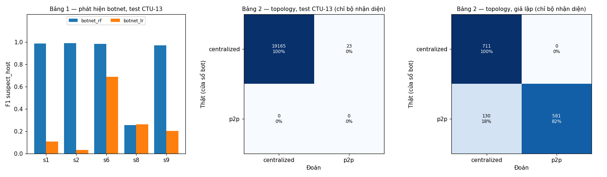

# C08-T08 — Đánh giá phát hiện botnet và nhận diện topology bằng hai bảng riêng

Mã nguồn: `evaluate`, `topology_tables`, `plot_tables`, `cmd_evaluate` trong `src/nids/botnet.py`.
Kiểm thử: `tests/test_botnet.py`. Kết quả: `docs/hinh/botnet_danh_gia.json`,
`docs/hinh/botnet_danh_gia.png`.

```bash
cd src
python -m nids.botnet danh-gia ../output/ctu13 --sim-dir ../output/topology_sim \
    --model ../models/botnet_rf.joblib --model ../models/botnet_lr.joblib --chon botnet_rf --out ../docs/hinh
```

Đây là **lần đầu đọc tập test** của Chặng 8 (scenario 1, 2, 6, 8, 9). Mô hình, ngưỡng và quy tắc đã
chốt ở C08-T05 và T07; không chỉnh gì sau khi xem kết quả. Theo B06 và B20, phát hiện botnet và
topology báo cáo **riêng**.



## Bảng 1 — Phát hiện botnet (mức host–cửa sổ, test CTU-13)

Test: 19 188 cửa sổ `suspect_host`, 24 880 cửa sổ `normal_host`, 148 720 cửa sổ Background.

| | Random Forest (chọn) | Logistic Regression |
|---|---|---|
| Ngưỡng (chọn trên validation) | 0,10 | 0,30 |
| Precision | **0,971** | 0,949 |
| Recall | **0,678** | 0,132 |
| F1 | **0,798** | 0,232 |
| Tỷ lệ báo nhầm (máy bình thường) | 1,58% | 0,55% |
| Cửa sổ Background bị báo (không phải FPR) | 11,9% | 10,7% |
| Host bot bị bắt ít nhất một cửa sổ | 14/14 | 14/14 |

Theo scenario (Random Forest):

| Scenario | Bot | Cửa sổ bot / bình thường | Precision | Recall | F1 | Báo nhầm | Background bị báo | LR F1 |
|---|---|---|---|---|---|---|---|---|
| 1 | Neris | 1 718 / 5 221 | 0,979 | 0,997 | **0,988** | 0,71% | 4,6% | 0,107 |
| 2 | Neris | 1 243 / 1 746 | 1,000 | 0,981 | **0,990** | 0% | 12,4% | 0,032 |
| 6 | DonBot | 746 / 1 403 | 0,993 | 0,976 | **0,984** | 0,36% | 3,2% | 0,688 |
| 8 | Murlo | 6 723 / 12 184 | 0,770 | 0,154 | **0,256** | 2,54% | 16,7% | 0,264 |
| 9 | Neris (10 bot) | 8 758 / 4 326 | 0,995 | 0,948 | **0,971** | 0,99% | 9,4% | 0,202 |

Đọc kết quả:
- RF hơn LR rõ rệt ở mọi scenario trừ 8. Kết luận chọn RF của C08-T05 đứng vững trên test, kể cả
  với họ bot **chưa từng thấy ở train** (Neris, DonBot, Murlo).
- **Scenario 8 (Murlo) bị bỏ sót nhiều.** 4 909 trong 6 723 cửa sổ bot chỉ có 2–3 flow botnet (chủ yếu
  `TCP-Attempt` chậm): 1 peer, 2 flow, trông như máy đang rảnh. RF bắt 0% cửa sổ có 1–3 flow botnet,
  54% cửa sổ có 11–50 flow, và **100%** cửa sổ có trên 50 flow. Cùng hiện tượng với quét cổng ít hoạt
  động ở Chặng 7: nhãn "có ≥ 1 flow botnet" gồm nhiều cửa sổ gần như không có hành vi.
- **Cửa sổ Background bị báo trên test là 11,9%**, vượt mức 5% đã giữ trên validation (scenario 8:
  16,7%; 2: 12,4%). Một phần có thể là máy nhiễm thật chưa được gán nhãn, nhưng không kiểm chứng được.
  Con số này cho thấy báo động trên máy lạ chưa ổn định giữa các bản thu.
- Precision 0,97 nghĩa là khi RF báo một cửa sổ của máy đã biết nhãn thì gần như đúng. Nhưng máy bình
  thường đã xác nhận chỉ là 4 máy, lặp lại ở mọi tập (docs/48): con số báo nhầm 1,6% chưa đại diện
  cho một mạng lạ.

**Trên dữ liệu giả lập** (cùng mô hình học từ CTU-13): recall chỉ 0,017. Cửa sổ bị báo: tập trung 0%,
P2P 2,5%, đối chứng tập trung 0%, đối chứng ngang hàng 0,9%. Bot giả lập gọi về nhẹ nhàng mỗi 20–60
giây, khác hẳn bot CTU-13 năm 2011 (spam, quét, DDoS dồn dập). Mô hình học từ CTU-13 **không chuyển
sang được** kiểu hành vi này; với lab cần học lại trên dữ liệu lab (Chặng 11).

## Bảng 2 — Nhận diện topology

Bộ nhận diện là quy tắc của C08-T07, đo theo hai cách:
- **Chỉ bộ nhận diện**: chạy trên đúng các cửa sổ bot thật, để đo riêng quy tắc.
- **Nối tiếp bộ phát hiện**: RF quyết định cửa sổ nào bị nghi, rồi quy tắc gán topology. Cửa sổ không
  bị nghi là `none`; đo trên mọi cửa sổ có nhãn.

### 2a. Chỉ bộ nhận diện (cửa sổ bot thật)

| Dữ liệu | Thật `centralized` → đoán centralized / p2p | Thật `p2p` → đoán centralized / p2p | Scenario / lần chạy đúng |
|---|---|---|---|
| CTU-13 test (1, 2, 6, 8, 9) | **19 165** / 23 (99,9%) | không có P2P | 5/5 |
| CTU-13 train + validation (để so) | 15 433 / 0 (100%) | 34 / **663** (95,1%) | 8/8 |
| Giả lập (12 lần chạy) | **711** / 0 (100%) | 130 / **581** (81,7%) | 11/12 |

Mức lần chạy trên giả lập (hàng: thật, cột: đoán):

| | centralized | p2p | none |
|---|---|---|---|
| centralized | 3 | 0 | 0 |
| p2p | 1 | 2 | 0 |
| none (đối chứng) | 0 | 0 | 6 |

Lần chạy P2P bị xếp nhầm là `p2p_2` (chu kỳ 60 giây, jitter 50%): trong 120 giây bot chỉ có vài peer
gọi vào, dưới ngưỡng 5. Đối chứng được xếp `none` vì ở cách đo này chúng không có cửa sổ bot nào; cách
đo 2b mới cho thấy bộ phát hiện có báo nhầm đối chứng hay không.

### 2b. Nối tiếp bộ phát hiện

CTU-13 test, mức cửa sổ:

| Thật \ Đoán | centralized | p2p | none |
|---|---|---|---|
| centralized | 12 976 | 23 | 6 189 |
| p2p | 0 | 0 | 0 |
| none (máy bình thường) | 357 | 37 | 24 486 |

Mức scenario: 5/5 đúng `centralized`. Mọi lỗi ở đây đến từ bộ phát hiện (bỏ sót, báo nhầm), không
từ quy tắc topology.

Giả lập, mức lần chạy:

| Thật \ Đoán | centralized | p2p | none |
|---|---|---|---|
| centralized | 0 | 0 | **3** |
| p2p | 0 | 2 | 1 |
| none (đối chứng) | 1 | 0 | 5 |

Vì bộ phát hiện học từ CTU-13 gần như không báo trên giả lập, cả ba lần chạy tập trung thành `none`.
Một lần đối chứng ngang hàng lành tính bị báo `centralized` (vài cửa sổ bị báo trong lần chạy đó).

## Kết luận

| Phần | Đạt | Chưa đạt |
|---|---|---|
| Phát hiện botnet trên CTU-13 | F1 0,97–0,99 ở 4/5 scenario test, kể cả họ bot chưa thấy; bắt được mọi host bot | Murlo (bot chậm) F1 0,26; Background bị báo 11,9%; chỉ 4 máy bình thường |
| Nhận diện topology (quy tắc) | 99,9% cửa sổ tập trung CTU-13 test, 100% tập trung và 82% P2P giả lập | Không có P2P trong test CTU-13; P2P chu kỳ dài bị nhầm; không phân biệt đối chứng tập trung |
| Chuyển sang dữ liệu khác | | Bộ phát hiện học từ CTU-13 không phát hiện bot giả lập (recall 0,017) |

Cảnh báo của module này chỉ thể hiện **mức nghi vấn** (B25). Kết quả trên giả lập chỉ kiểm tra logic;
kết quả cuối cùng phải đo trên lab (Chặng 11).

## Kiểm thử

- Bảng topology: cách đo "chỉ bộ nhận diện" đếm đúng số cửa sổ bot thật; cách "nối tiếp" đếm mọi cửa
  sổ có nhãn; có kết quả theo từng nhóm.
- Các phần dùng lại đã kiểm thử ở T05 (đánh giá theo scenario, Background) và T07 (quy tắc, nhãn đa
  số, confusion matrix).

## Thuật ngữ

Giải thích ngắn các thuật ngữ dùng trong tài liệu này.

| Thuật ngữ | Giải thích |
|---|---|
| Host–cửa sổ | Một máy trong một cửa sổ 120 giây |
| Precision, Recall, F1 | Tỷ lệ báo đúng; tỷ lệ bắt được; trung bình điều hòa |
| Tỷ lệ báo nhầm | Phần cửa sổ của máy bình thường đã xác nhận bị báo là bot |
| Background bị báo | Phần cửa sổ của máy chưa kiểm chứng bị báo; không phải tỷ lệ báo nhầm |
| Nối tiếp | Chạy bộ nhận diện topology trên kết quả của bộ phát hiện |
| Confusion matrix | Bảng đếm theo nhãn thật (hàng) và nhãn đoán (cột) |
| Neris, DonBot, Murlo | Ba họ bot của tập test, không có ở train |
| TCP-Attempt | Lần thử kết nối TCP của bot không thành công |
| Chuyển sang dữ liệu khác | Mô hình học trên một bộ dữ liệu có dùng được cho dữ liệu khác hay không |
