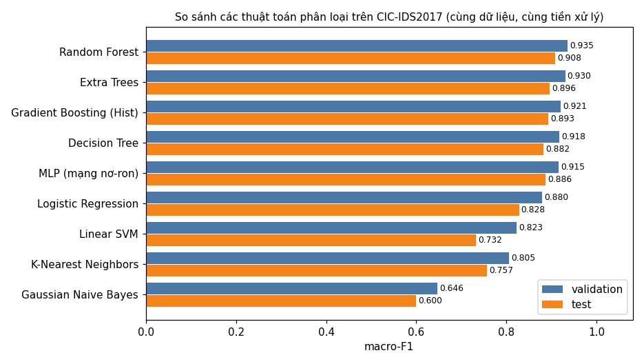

# So sánh với các mô hình baseline

Tài liệu này trả lời yêu cầu "so sánh với ít nhất 5 mô hình baseline" cho module phân loại tấn công
(`benign` / `port_scan` / `dos`). Có **8 baseline** được so với mô hình đề tài chọn là Random Forest.

Mã nguồn: `src/nids/so_sanh_mo_hinh.py`. Kết quả: `docs/hinh/so_sanh_mo_hinh.json`. Hình:
`docs/hinh/so_sanh_mo_hinh.png`.

## 1. Baseline là gì và để làm gì

Baseline là **mô hình mốc để so sánh**. Một con số như "macro-F1 0,908" đứng một mình không nói được mô hình
tốt hay kém. Phải đặt cạnh các mô hình khác chạy trên **cùng dữ liệu** mới trả lời được ba câu hỏi:

1. Bài toán khó tới đâu? Nếu mô hình đơn giản nhất đã đạt điểm cao thì không cần mô hình phức tạp.
2. Mô hình được chọn có thật sự hơn các lựa chọn khác không, và hơn bao nhiêu?
3. Cái giá phải trả (thời gian học, thời gian dự đoán) có đáng không?

## 2. Điều kiện so sánh

Mọi mô hình dùng chung những thứ sau, chỉ khác thuật toán:

| Thành phần | Giá trị |
|---|---|
| Dữ liệu | CIC-IDS2017 thứ Tư (DoS) và thứ Sáu (quét cổng), bảng cửa sổ host 10 giây bước 2 giây |
| Chia tập | 60% train, 20% validation, 20% test, chia theo thời gian (docs/29) |
| Train | 85 989 cửa sổ sau khi bỏ mẫu trùng: 83 346 `benign`, 2 165 `dos`, 478 `port_scan` |
| Validation | 54 761 cửa sổ: 53 949 `benign`, 648 `dos`, 164 `port_scan` |
| Test | 68 660 cửa sổ: 67 713 `benign`, 727 `dos`, 220 `port_scan` |
| Đặc trưng | 20 đặc trưng của cửa sổ host (docs/23) |
| Tiền xử lý | Điền ô trống bằng trung vị, lấy logarit các cột đếm, chuẩn hóa; tham số tính trên train (docs/32) |
| Cách ghép | Mỗi mô hình là một `sklearn.pipeline.Pipeline` gồm hai bước: tiền xử lý rồi phân loại |
| Thước đo | Macro-F1 (trung bình F1 của ba lớp), vì dữ liệu rất lệch: 97% là `benign` |

Không dùng accuracy làm thước đo chính: mô hình đoán mọi cửa sổ là `benign` cũng đạt accuracy khoảng 98,6%
trên test mà không bắt được tấn công nào.

Logistic Regression và Random Forest dùng tham số đã dò trên validation ở Chặng 7 (docs/42). Sáu mô hình còn
lại dùng tham số ghi ở mục 3, **không dò tham số**. Vì vậy bảng cho biết thứ hạng tương đối, không phải giới
hạn tốt nhất của từng thuật toán.

## 3. Công dụng của từng baseline

| # | Baseline | Cách hoạt động | Dùng làm mốc cho điều gì | Tham số |
|---|---|---|---|---|
| 1 | **Gaussian Naive Bayes** | Giả định các đặc trưng độc lập với nhau, mỗi lớp có một phân phối chuẩn riêng cho từng đặc trưng; chọn lớp có xác suất cao nhất | Mốc thấp nhất: mô hình xác suất đơn giản nhất. Cho biết nếu bỏ qua quan hệ giữa các đặc trưng thì được bao nhiêu | Mặc định |
| 2 | **Logistic Regression** | Tính tổng có trọng số của các đặc trưng rồi đổi thành xác suất; ranh giới giữa các lớp là mặt phẳng | Mốc tuyến tính: cho biết bài toán có tách được bằng đường thẳng không. Hệ số dễ đọc nên giải thích được | `C = 0,1` |
| 3 | **Linear SVM** | Tìm mặt phẳng chia hai lớp sao cho khoảng cách tới các điểm gần nhất là lớn nhất | Mốc tuyến tính thứ hai, tối ưu theo tiêu chí khác Logistic Regression. Hai mô hình cùng thấp nghĩa là nguyên nhân nằm ở tính tuyến tính | `C = 1` |
| 4 | **K-Nearest Neighbors** | Không học gì; khi dự đoán thì tìm 5 mẫu train gần nhất và lấy nhãn chiếm đa số | Mốc dựa trên độ giống nhau: cho biết các cửa sổ tấn công có nằm gần nhau trong không gian đặc trưng không | `k = 5` |
| 5 | **Decision Tree** | Một cây các câu hỏi dạng "đặc trưng X lớn hơn ngưỡng T không?" | Mốc phi tuyến đơn giản nhất và là thành phần của Random Forest. So với nó để biết việc ghép nhiều cây có ích không | Sâu tối đa 20 |
| 6 | **Extra Trees** | Giống Random Forest nhưng ngưỡng chia ở mỗi nút được chọn ngẫu nhiên thay vì chọn ngưỡng tốt nhất | Mốc cùng họ rừng cây: cho biết kết quả của Random Forest có phụ thuộc cách dựng cây cụ thể không | 300 cây, sâu 20 |
| 7 | **Gradient Boosting** (bản histogram) | Dựng các cây nối tiếp nhau, cây sau sửa lỗi của các cây trước | Mốc mạnh: họ thuật toán thường đứng đầu trên dữ liệu dạng bảng. Nếu nó hơn hẳn thì nên đổi mô hình | 200 vòng, tốc độ học 0,1 |
| 8 | **MLP** (mạng nơ-ron nhiều lớp) | Hai lớp ẩn 64 và 32 nơ-ron, học bằng lan truyền ngược | Mốc học sâu: cho biết mạng nơ-ron có lợi thế trên 20 đặc trưng này không | 2 lớp ẩn, 200 vòng |
| — | **Random Forest** (mô hình đề tài chọn) | 300 cây quyết định, mỗi cây học trên một phần dữ liệu và một phần đặc trưng ngẫu nhiên, lấy đa số phiếu | — | 300 cây, sâu 20 |

## 4. Kết quả

Sắp theo macro-F1 trên validation. Cột `port_scan` và `dos` là F1 của từng lớp trên test. "Báo nhầm" là tỷ lệ
cửa sổ `benign` của test bị gán thành tấn công.

| Mô hình | Macro-F1 validation | Macro-F1 test | F1 `port_scan` | F1 `dos` | Báo nhầm | Học (giây) | Dự đoán test (giây) |
|---|---|---|---|---|---|---|---|
| **Random Forest** | **0,935** | **0,908** | 0,829 | **0,896** | 0,041% | 6,4 | 0,44 |
| Extra Trees | 0,931 | 0,896 | 0,813 | 0,877 | 0,030% | 3,1 | 0,47 |
| Gradient Boosting | 0,921 | 0,893 | 0,796 | 0,885 | 0,052% | 4,1 | 0,12 |
| Decision Tree | 0,918 | 0,882 | 0,791 | 0,857 | 0,155% | 0,9 | 0,08 |
| MLP | 0,915 | 0,887 | **0,837** | 0,825 | 0,282% | 22,6 | 0,11 |
| Logistic Regression | 0,880 | 0,828 | 0,676 | 0,810 | **0,016%** | 0,9 | 0,06 |
| Linear SVM | 0,823 | 0,732 | 0,442 | 0,757 | 0,038% | 1,3 | 0,09 |
| K-Nearest Neighbors | 0,806 | 0,757 | 0,813 | 0,468 | 1,892% | 0,3 | 4,87 |
| Gaussian Naive Bayes | 0,646 | 0,600 | 0,215 | 0,592 | 1,131% | 0,3 | 0,09 |



Việc chọn mô hình chỉ dựa trên cột validation. Cột test được đọc sau, để báo cáo.

## 5. Nhận xét

- **Random Forest đứng đầu ở cả validation và test**, nên lựa chọn của Chặng 7 đứng vững khi so với 8 mô hình
  thay vì chỉ một.
- **Các mô hình dựa trên cây đều ở nhóm đầu** (0,88–0,91 trên test). Lý do: dấu hiệu tấn công có dạng ngưỡng,
  ví dụ "số cổng đích lớn hơn vài chục", đúng kiểu câu hỏi mà cây đặt ra.
- **Mô hình tuyến tính thấp hơn rõ** (Logistic Regression 0,828, Linear SVM 0,732). Ranh giới giữa bình thường
  và tấn công không phải mặt phẳng: máy chủ bận rộn và máy bị DoS đều có nhiều kết nối, phải xét kết hợp nhiều
  đặc trưng mới tách được.
- **Gaussian Naive Bayes thấp nhất** (0,600). Giả định các đặc trưng độc lập sai nặng ở đây: số gói, số byte,
  số kết nối tăng giảm cùng nhau.
- **K-Nearest Neighbors bắt quét cổng tốt nhưng báo nhầm nhiều nhất** (1,9% cửa sổ bình thường, gấp khoảng 46
  lần Random Forest) và dự đoán chậm nhất (4,87 giây so với 0,44 giây), không hợp với realtime.
- **Khoảng cách giữa ba mô hình đầu là nhỏ** (0,908 / 0,896 / 0,893) và sáu baseline chưa được dò tham số. Kết
  luận đúng mức là: Random Forest không kém mô hình nào đã thử. Chưa thể nói nó hơn Gradient Boosting một
  cách chắc chắn.
- **Gradient Boosting dự đoán nhanh hơn Random Forest gần 4 lần** với điểm thấp hơn 0,015. Nếu sau này cần giảm
  tải cho cảm biến thì đây là ứng viên thay thế.
- **Mọi mô hình đều yếu nhất ở `port_scan`** trên test. Tập test chỉ có 220 cửa sổ quét, trong đó có các lượt
  quét chậm chỉ vài gói mỗi cửa sổ (docs/44). Đây là giới hạn của dữ liệu, không riêng mô hình nào.

## 6. Chạy lại

```
cd src
python -m nids.so_sanh_mo_hinh ../output/features/cic17_wednesday ../output/features/cic17_friday --chon ../docs/hinh/phan_loai_chon.json --out ../docs/hinh
```

Chạy khoảng 2 phút. Cần có bảng đặc trưng trong `output/features/` (tạo ở Chặng 4 và 5).

## 7. Phạm vi

- Chỉ so sánh cho **module phân loại tấn công**. Module bất thường (Gaussian) học không giám sát nên không so
  trực tiếp với các mô hình có giám sát này. Module botnet đã có Logistic Regression làm baseline (docs/49).
- Chỉ trên CIC-IDS2017. Chưa chạy bảng này trên dữ liệu lab.

## Thuật ngữ

| Thuật ngữ | Giải thích |
|---|---|
| Baseline | Mô hình mốc, dùng để so sánh với mô hình chính |
| Macro-F1 | Trung bình cộng điểm F1 của từng lớp; lớp ít mẫu được tính ngang lớp nhiều mẫu |
| F1 | Điểm gộp precision (báo đúng bao nhiêu) và recall (bắt được bao nhiêu) |
| Accuracy | Tỷ lệ dự đoán đúng trên tổng số mẫu |
| Train / validation / test | Tập để học / để chọn mô hình và tham số / để đánh giá cuối |
| Cửa sổ host | Hành vi của một máy trong 10 giây, tóm tắt thành 20 con số |
| Đặc trưng | Một con số mô tả hành vi, ví dụ số cổng đích khác nhau |
| Pipeline (scikit-learn) | Chuỗi các bước xử lý nối nhau, ở đây là tiền xử lý rồi phân loại |
| Tuyến tính / phi tuyến | Ranh giới giữa các lớp là mặt phẳng / là hình dạng bất kỳ |
| Dò tham số | Thử nhiều giá trị tham số và chọn giá trị tốt nhất trên validation |
| Trung vị | Giá trị đứng giữa khi sắp các số theo thứ tự |
| Chuẩn hóa | Đưa mỗi đặc trưng về trung bình 0, độ lệch chuẩn 1 |
| `benign`, `port_scan`, `dos` | Ba lớp: bình thường, quét cổng, tấn công từ chối dịch vụ |
