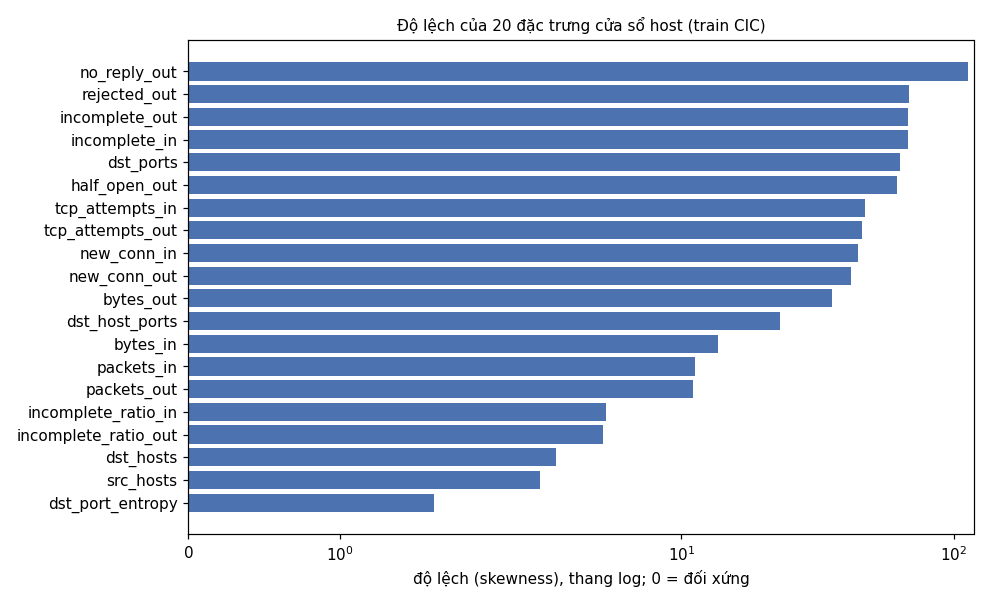
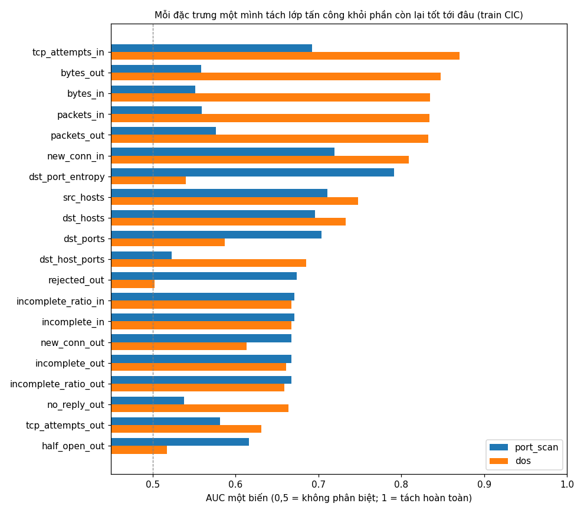
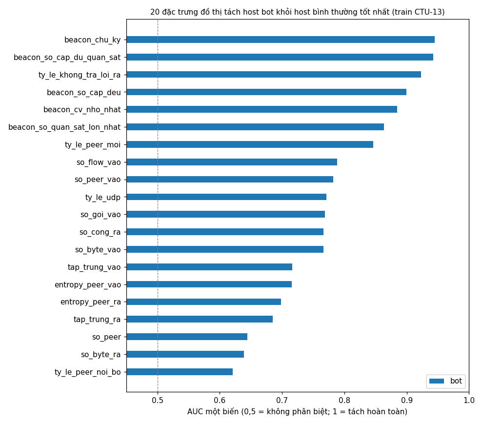
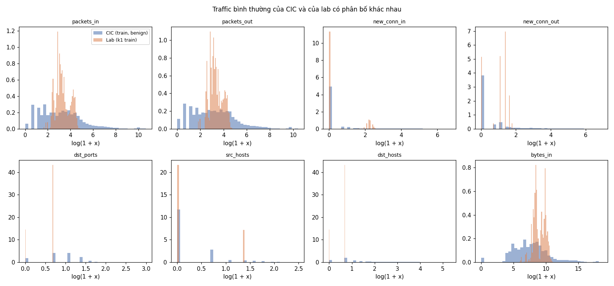

# EDA tổng hợp ba bộ dữ liệu

Tài liệu gom phân tích khám phá dữ liệu (EDA) của cả ba bộ dữ liệu đề tài dùng: CIC-IDS2017, CTU-13 và lab ảo.
Phần chi tiết riêng của CIC đã có ở docs/31 (phân bố lớp, đặc trưng flow, đặc trưng cửa sổ theo lớp, tương
quan, một đợt tấn công theo thời gian); tài liệu này bổ sung tổng quan kích thước, chất lượng dữ liệu, độ lệch,
mức mất cân bằng, khả năng phân biệt của từng đặc trưng, dữ liệu botnet CTU-13 và độ lệch giữa CIC và lab.

Mã nguồn: `src/nids/eda_tong_hop.py` (bổ sung `src/nids/eda.py`). Số liệu và hình: `docs/hinh/eda_tong_hop/`.

```bash
cd src
python -m nids.eda_tong_hop --cic ../output/features --ctu13 ../output/ctu13 \
    --lab ../output/lab_features_h1 --nhat-ky ../data/run_logs --out ../docs/hinh/eda_tong_hop
```

**Chống rò rỉ:** mọi thống kê theo nhãn chỉ tính trên **tập train**; validation và test chỉ được đếm số mẫu.

## 1. Tổng quan kích thước

| Bộ dữ liệu | Phần dùng | Kích thước | Đơn vị mô hình nhìn |
|---|---|---|---|
| CIC-IDS2017 thứ Hai | Chỉ traffic bình thường | 11,66 triệu gói → 381 707 flow → 152 513 cửa sổ host | Cửa sổ host 10 giây |
| CIC-IDS2017 thứ Tư | DoS (Hulk, GoldenEye, slowloris, Slowhttptest) | 13,73 triệu gói → 506 163 flow → 163 431 cửa sổ | Cửa sổ host 10 giây |
| CIC-IDS2017 thứ Sáu | Quét cổng (Nmap) | 9,94 triệu gói → 555 024 flow → 149 449 cửa sổ | Cửa sổ host 10 giây |
| CTU-13 | 13 kịch bản botnet thật | 515 984 host–cửa sổ 120 giây | Host–cửa sổ 120 giây |
| Lab ảo 9 máy | 21 biến thể kịch bản | 274 lần chạy có nhật ký | Cả hai loại cửa sổ |

## 2. Phân bố lớp và mất cân bằng

Cửa sổ host của CIC (cả ba ngày, chỉ mẫu có nhãn chắc chắn):

| Tập | `benign` | `dos` | `port_scan` |
|---|---|---|---|
| Train | 252 221 | 2 270 | 707 |
| Validation | 84 958 | 648 | 164 |
| Test | 99 988 | 727 | 220 |

Trong train, cứ **111** cửa sổ bình thường mới có 1 cửa sổ DoS, và **357** cửa sổ bình thường mới có 1 cửa sổ quét
cổng. Hệ quả cho cả đề tài:

- Accuracy không dùng được làm thước đo: đoán mọi thứ là `benign` đã đạt khoảng 99%. Đề tài dùng **macro-F1**.
- Đã thử giảm mẫu `benign` và đặt trọng số lớp khi chọn mô hình (docs/42); với Random Forest, validation chọn
  không cân bằng.

Host–cửa sổ của CTU-13:

| Tập | Bot (`suspect_host`) | Máy bình thường đã xác nhận | Background (chưa rõ) | Bỏ (mơ hồ) |
|---|---|---|---|---|
| Train | 9 575 | 32 827 | 183 958 | 11 977 |
| Validation | 6 555 | 10 453 | 60 131 | 1 231 |
| Test | 19 188 | 24 880 | 148 720 | 6 489 |

Phần lớn host của CTU-13 là **Background**: máy chưa được xác nhận là bot hay bình thường. Chúng không dùng làm
mẫu dương, và tỷ lệ Background bị báo được giới hạn ở 5% khi chọn ngưỡng (QĐ-040).

## 3. Chất lượng dữ liệu (train CIC, 255 198 cửa sổ)

| Kiểm tra | Kết quả | Xử lý |
|---|---|---|
| Ô trống | Chỉ ở 3 cột tỷ lệ/entropy: `incomplete_ratio_out` 75%, `incomplete_ratio_in` 94%, `dst_port_entropy` 14% | Trống là đúng nghĩa: máy không mở kết nối TCP nào thì không có tỷ lệ. Điền trung vị và thêm cột đánh dấu "vốn trống" (docs/32) |
| Cửa sổ trùng hệt cả đặc trưng lẫn nhãn | **46%** | Phần lớn là cửa sổ máy im lặng, giống nhau từng con số. Bỏ trùng trong train trước khi học (166 269 → 85 989 cửa sổ ở bộ phân loại) |
| Cùng đặc trưng nhưng khác nhãn | 11 nhóm | Rất ít; là cửa sổ ở rìa đợt tấn công |
| Cột hằng | Không có | — |

## 4. Thống kê mô tả và độ lệch



| Đặc trưng | Bằng 0 | Trung vị | Phân vị 99 | Lớn nhất | Độ lệch (skew) |
|---|---|---|---|---|---|
| `packets_out` | 2,9% | 20 | 3 686 | 33 425 | 11,0 |
| `bytes_out` | 2,9% | 2 028 | 493 873 | 30 795 933 | 35,8 |
| `dst_ports` | 13,6% | 2 | 5 | 998 | 63,5 |
| `new_conn_in` | 81,6% | 0 | 135 | 7 991 | 44,3 |
| `tcp_attempts_in` | 94,0% | 0 | 4 | 7 981 | 47,2 |
| `no_reply_out` | 98,7% | 0 | 1 | 808 | 112,4 |
| `dst_port_entropy` | 35,7% | 0,63 | 1,97 | 9,96 | 1,6 |

(Bảng đủ 20 đặc trưng ở `eda_tong_hop.json`, mục `cic.mo_ta_train`.)

- **Mọi đặc trưng đếm đều lệch phải rất mạnh**: trung vị nhỏ, phân vị 99 lớn hơn hàng trăm lần, giá trị lớn nhất
  lớn hơn hàng nghìn lần. Đây là lý do lấy `log(1 + x)` trước khi chuẩn hóa, và với Gaussian thì dùng thêm phép
  Yeo-Johnson (docs/34).
- **Nhiều đặc trưng phần lớn bằng 0**: 94% cửa sổ không nhận kết nối TCP nào. Tấn công nằm ở phần đuôi rất mỏng
  của phân bố, nên mô hình phải nhạy với giá trị hiếm.

## 5. Mỗi đặc trưng phân biệt lớp tốt tới đâu



AUC một biến: dùng riêng một đặc trưng làm điểm để tách một lớp tấn công khỏi phần còn lại; 0,5 là đoán mò, 1 là
tách hoàn toàn.

| Lớp | Ba đặc trưng mạnh nhất (AUC) |
|---|---|
| `dos` | `tcp_attempts_in` 0,87; `bytes_out` 0,85; `bytes_in` 0,83 |
| `port_scan` | `dst_port_entropy` 0,79; `new_conn_in` 0,72; `src_hosts` 0,71 |

- **Không đặc trưng nào một mình đủ tốt** (cao nhất 0,87). Phải kết hợp nhiều đặc trưng, và kết hợp kiểu phi tuyến:
  đây là lý do các mô hình cây vượt hẳn mô hình tuyến tính (docs/78).
- DoS dễ nhận hơn quét cổng: DoS làm tăng mạnh khối lượng và số lần mở kết nối, còn quét cổng trong CIC đi qua NAT
  và lẫn với traffic khác của cùng máy.
- Tương quan giữa các đặc trưng (docs/31 mục 5): nhóm gói/byte và nhóm số lần thử TCP tương quan rất cao với nhau,
  nên độ quan trọng của từng đặc trưng trong Random Forest bị chia nhỏ (docs/44).

## 6. Dữ liệu botnet CTU-13



Trung vị trên train:

| Đặc trưng | Host bình thường | Host bot |
|---|---|---|
| Số máy liên lạc (`so_peer`) | 8 | 58 |
| Mức tập trung vào một đối tác chiều ra (`tap_trung_ra`) | 0,67 | 0,02 |
| Số flow ra | 48 | 58 |
| Tỷ lệ kết nối ra không được trả lời | 0 | 0,97 |

Đặc trưng tách bot tốt nhất là **nhóm gọi định kỳ** (`beacon_chu_ky` AUC 0,94, `beacon_so_cap_du_quan_sat` 0,94)
và **tỷ lệ kết nối ra không được trả lời** (0,92). Bot của CTU-13 liên lạc với rất nhiều máy, phần lớn không trả
lời (spam, quét), còn máy bình thường nói chuyện với ít máy quen. Ô trống: các cột chiều vào và đặc trưng gọi định
kỳ trống ở 27–72% host–cửa sổ (máy không có kết nối vào, hoặc chưa đủ 5 lần liên lạc để đo nhịp).

## 7. Lab khác CIC thế nào



So cửa sổ bình thường của train CIC với cửa sổ của kịch bản bình thường `k1` trong lab:

| Đặc trưng | Trung vị CIC | Trung vị lab |
|---|---|---|
| `packets_in` | 19 | 23 |
| `bytes_in` | 1 902 | 6 345 |
| `new_conn_out` | 0 | 2 |
| `dst_hosts` | 2 | 1 |

Traffic bình thường của lab **hẹp và đều** (một bộ sinh, một máy chủ web), còn của CIC **rộng và đa dạng** (người
dùng thật, nhiều dịch vụ Internet). Hình cho thấy phân bố lab nằm gọn trong một khoảng nhỏ của phân bố CIC, với
các đỉnh nhọn. Đây là nguyên nhân mô hình học từ CIC báo nhầm trên lab (58 sự kiện, docs/71) và phải học lại trên
dữ liệu lab (docs/73, 76, 80).

## 8. Kết luận cho bước mô hình hóa

| Điều thấy trong EDA | Quyết định đã làm |
|---|---|
| Mất cân bằng 1 : 111 và 1 : 357 | Dùng macro-F1; thử cân bằng lớp khi chọn mô hình |
| Đặc trưng lệch phải rất mạnh, nhiều số 0 | `log(1 + x)` rồi chuẩn hóa; Yeo-Johnson cho Gaussian |
| 46% cửa sổ train trùng hệt | Bỏ trùng trong train; chia tập theo thời gian để test không trùng train |
| Ô trống có nghĩa | Điền trung vị kèm cột đánh dấu |
| Không đặc trưng nào một mình đủ, quan hệ phi tuyến | Chọn mô hình cây (Random Forest), so với 8 baseline (docs/78) và mô hình học sâu (docs/82) |
| Phân bố lab khác CIC | Học lại trên lab, chấm trên lần chạy lab mới |

## Thuật ngữ

| Thuật ngữ | Giải thích |
|---|---|
| EDA | Phân tích khám phá dữ liệu: xem dữ liệu trông thế nào trước khi xây mô hình |
| Cửa sổ host | Hành vi của một máy trong 10 giây, tóm tắt thành 20 con số |
| Host–cửa sổ 120 giây | Hành vi liên lạc của một máy trong 120 giây, dùng cho module botnet |
| Mất cân bằng lớp | Một lớp có nhiều mẫu hơn hẳn lớp khác |
| Trung vị, phân vị 99 | Giá trị đứng giữa; giá trị mà 99% mẫu nhỏ hơn |
| Độ lệch (skewness) | Mức phân bố bị kéo dài về một phía; số lớn là có vài giá trị rất lớn |
| AUC một biến | Dùng riêng một đặc trưng để tách lớp; 0,5 là đoán mò, 1 là tách hoàn toàn |
| Thông tin tương hỗ | Biết đặc trưng thì giảm được bao nhiêu độ không chắc về nhãn |
| Background (CTU-13) | Máy chưa được xác nhận là bot hay bình thường |
| Gọi định kỳ (beaconing) | Liên lạc theo chu kỳ đều, dấu hiệu thường thấy của bot |
| Macro-F1 | Trung bình F1 của các lớp, mỗi lớp tính ngang nhau |
| Rò rỉ dữ liệu | Thông tin của tập đánh giá lọt vào lúc học hoặc lúc chọn, làm điểm cao giả |
