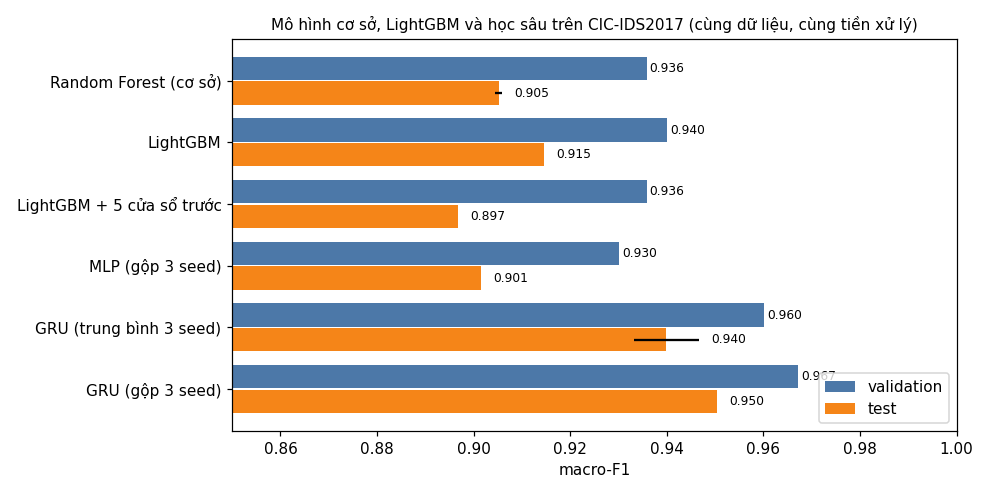

# LightGBM và mô hình học sâu so với mô hình cơ sở

Tài liệu so sánh Random Forest (mô hình cơ sở của bộ phân loại tấn công) với LightGBM và hai mô hình học sâu
(MLP và GRU) trên **cùng dữ liệu, cùng chia tập, cùng tiền xử lý**. Quyết định: QĐ-084.

Mã nguồn: `src/nids/hoc_sau.py`. Kết quả: `docs/hinh/hoc_sau/hoc_sau.json`. Hình: `docs/hinh/hoc_sau/so_sanh_hoc_sau.png`.

```bash
pip install lightgbm torch
cd src
python -m nids.hoc_sau ../output/features/cic17_wednesday ../output/features/cic17_friday \
    --chon ../docs/hinh/phan_loai_chon.json --out ../docs/hinh/hoc_sau
python -m nids.hoc_sau ../output/features/cic17_wednesday ../output/features/cic17_friday \
    --chon ../docs/hinh/phan_loai_chon.json --out ../docs/hinh/hoc_sau --chi-ngu-canh
```

Chạy khoảng 50 phút trên CPU 12 luồng.

## 1. LightGBM có phải học sâu không

**Không.** LightGBM là thuật toán **cây tăng cường theo gradient**: dựng nhiều cây quyết định nối tiếp nhau, cây
sau sửa lỗi của các cây trước. Nó cùng họ với Gradient Boosting trong docs/78, không có mạng nơ-ron. Vì vậy tài
liệu này làm cả hai: LightGBM (mô hình cây mạnh) và hai mạng nơ-ron thật (học sâu).

## 2. Các mô hình

| Mô hình | Loại | Đầu vào | Cách chọn tham số |
|---|---|---|---|
| **Random Forest** (mô hình cơ sở) | Rừng cây | 20 đặc trưng của cửa sổ hiện tại | Tham số đã chọn ở Chặng 7 (300 cây, sâu 20) |
| **LightGBM** | Cây tăng cường | 20 đặc trưng của cửa sổ hiện tại | Lưới 24 bộ (số lá, tốc độ học, số mẫu tối thiểu ở lá, trọng số lớp), dừng sớm theo validation |
| **MLP** | Học sâu: mạng nơ-ron truyền thẳng, 2 lớp ẩn | 20 đặc trưng của cửa sổ hiện tại | Lưới 12 bộ (kích thước lớp ẩn, trọng số lớp, tốc độ học) |
| **GRU** | Học sâu: mạng nơ-ron hồi quy | **Chuỗi** 6 cửa sổ: 5 cửa sổ trước đó của cùng máy và cửa sổ hiện tại, kèm khoảng cách thời gian | Lưới 12 bộ như MLP |
| LightGBM + ngữ cảnh | Cây tăng cường | Cùng chuỗi 6 cửa sổ như GRU, trải phẳng | Lưới 24 bộ như LightGBM |

Điều kiện chung:

- Dữ liệu: CIC-IDS2017 thứ Tư và thứ Sáu, cửa sổ host 10 giây; chia 60/20/20 theo thời gian (docs/29).
- Train 85 989 cửa sổ (83 346 `benign`, 2 165 `dos`, 478 `port_scan`); validation 54 761; test 68 660.
- Tiền xử lý: điền trung vị, `log(1 + x)`, chuẩn hóa; tham số tính trên train (docs/32). Sau tiền xử lý mỗi cửa sổ
  là 23 cột: 20 đặc trưng và 3 cột đánh dấu ô vốn trống.
- Mạng nơ-ron: tối ưu Adam, entropy chéo, dropout 0,2, lô 512, dừng sớm khi macro-F1 validation không tăng sau 8
  vòng. Mỗi mô hình học với 3 seed khác nhau; "gộp 3 seed" là trung bình xác suất của 3 mạng.
- **Mọi lựa chọn chỉ dựa trên validation; test đọc một lần ở cuối.**

GRU chỉ nhìn các cửa sổ **trước** cửa sổ đang chấm, nên chạy được trong realtime: cảm biến đã giữ các cửa sổ gần
đây của từng máy.

## 3. Kết quả



| Mô hình | Macro-F1 validation | **Macro-F1 test** | F1 `port_scan` | F1 `dos` | Cửa sổ `benign` bị báo |
|---|---|---|---|---|---|
| Random Forest (cơ sở) | 0,936 | 0,905 | 0,823 | 0,897 | 0,041% |
| LightGBM | 0,940 | 0,915 | 0,845 | 0,900 | 0,072% |
| LightGBM + 5 cửa sổ trước | 0,936 | 0,897 | 0,776 | 0,916 | 0,068% |
| MLP (gộp 3 seed) | 0,930 | 0,902 | 0,807 | 0,899 | 0,019% |
| **GRU** (trung bình 3 seed) | 0,960 | **0,940 ± 0,007** | 0,913 | 0,935 | 0,092% |
| **GRU (gộp 3 seed)** | 0,967 | **0,950** | 0,907 | **0,945** | 0,044% |

Chi tiết theo lớp (test):

| Mô hình | `port_scan` precision / recall | `dos` precision / recall |
|---|---|---|
| Random Forest (cơ sở) | 0,947 / 0,727 | 0,962 / 0,840 |
| LightGBM | 0,874 / 0,818 | 0,957 / 0,850 |
| GRU (gộp 3 seed) | 0,929 / **0,886** | 0,970 / **0,922** |

Ba lần học GRU với ba seed cho test 0,949 / 0,938 / 0,933; lần thấp nhất vẫn cao hơn mô hình cơ sở 0,028.

## 4. Nhận xét

- **Mô hình học sâu GRU cao hơn mô hình cơ sở**: macro-F1 test 0,950 so với 0,905 (gộp 3 seed), hoặc
  0,940 ± 0,007 nếu lấy trung bình từng mạng. Cả ba seed đều cao hơn.
- **Phần tăng đến từ việc đọc chuỗi**. Recall quét cổng tăng từ 0,73 lên 0,89 và recall DoS từ 0,84 lên 0,92: quét
  chậm và DoS HTTP chậm trải dài nhiều cửa sổ. Từng cửa sổ riêng lẻ có thể trông bình thường, nhưng chuỗi thì không.
- **Không phải chỉ vì có thêm dữ liệu.** Đưa cùng 5 cửa sổ trước đó cho LightGBM (trải phẳng thành 150 cột) không
  tăng mà còn giảm (0,897). Mạng hồi quy dùng chung một bộ trọng số cho mọi bước thời gian nên học được "nhịp" của
  chuỗi, còn cây phải học riêng từng cột.
- **MLP, mạng học sâu không có chuỗi, không vượt Random Forest** (0,902 so với 0,905). Học sâu trên 20 đặc trưng
  dạng bảng không tự động tốt hơn cây; lợi thế chỉ xuất hiện khi mô hình được nhìn chuỗi thời gian.
- **LightGBM cao hơn Random Forest một chút** (0,915 so với 0,905) nhờ recall quét cổng tốt hơn, đổi lại báo nhầm
  nhiều hơn (0,072% so với 0,041% cửa sổ bình thường).
- **Đổi chác của GRU:** từng mạng GRU báo nhầm nhiều hơn mô hình cơ sở (0,092%); gộp 3 seed đưa về 0,044%, ngang mô
  hình cơ sở. GRU học mất khoảng 1 phút mỗi seed trên CPU, Random Forest khoảng 7 giây.

## 5. Giới hạn

- Chỉ đo trên CIC-IDS2017. Hệ thống đang chạy (pipeline, cảm biến, lab) **vẫn dùng Random Forest**; GRU chưa được
  nối vào cảm biến và chưa thử trên lab.
- Lưới tham số của mạng nơ-ron nhỏ (12 bộ) và chọn bằng một seed; validation của GRU khi học lại bằng 3 seed
  (0,960) thấp hơn số tốt nhất lúc dò (0,972), tức số lúc dò hơi lạc quan. Test vẫn chỉ đọc một lần.
- Validation `port_scan` chỉ có 164 cửa sổ, test 220, nên chênh lệch nhỏ giữa các mô hình (dưới 0,01) không chắc
  chắn. Chênh lệch giữa GRU và mô hình cơ sở (0,035–0,045) lớn hơn nhiều mức dao động giữa các seed (0,007).

## Thuật ngữ

| Thuật ngữ | Giải thích |
|---|---|
| Mô hình cơ sở | Mô hình mốc để so sánh; ở đây là Random Forest đã dùng trong hệ thống |
| LightGBM | Thư viện cây tăng cường theo gradient: nhiều cây nối tiếp, cây sau sửa lỗi cây trước. Không phải học sâu |
| Học sâu | Mô hình mạng nơ-ron nhiều lớp, học bằng lan truyền ngược |
| MLP | Mạng nơ-ron truyền thẳng: dữ liệu đi qua các lớp nơ-ron một chiều từ đầu vào tới đầu ra |
| GRU | Mạng nơ-ron hồi quy: đọc từng phần tử của chuỗi theo thứ tự, mang theo "trí nhớ" từ các bước trước |
| Chuỗi cửa sổ, ngữ cảnh | Các cửa sổ 10 giây liên tiếp của cùng một máy; ở đây là 5 cửa sổ trước và cửa sổ hiện tại |
| Seed | Số khởi tạo cho phần ngẫu nhiên; đổi seed thì mạng khởi đầu khác nên kết quả khác đôi chút |
| Gộp seed | Lấy trung bình xác suất của nhiều mạng học với seed khác nhau |
| Dừng sớm | Ngừng học khi điểm trên validation không còn tăng, để tránh học thuộc train |
| Dropout | Tắt ngẫu nhiên một phần nơ-ron lúc học để mạng không phụ thuộc vào vài nơ-ron |
| Adam, entropy chéo | Thuật toán cập nhật trọng số; hàm đo mức sai của xác suất dự đoán |
| Macro-F1 | Trung bình F1 của ba lớp, mỗi lớp tính ngang nhau |
| Precision / recall | Trong các cảnh báo, tỷ lệ đúng / trong các tấn công thật, tỷ lệ bắt được |
