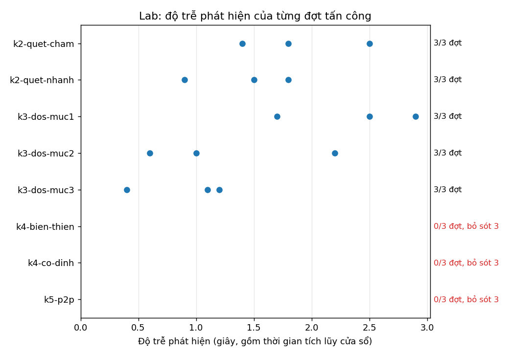
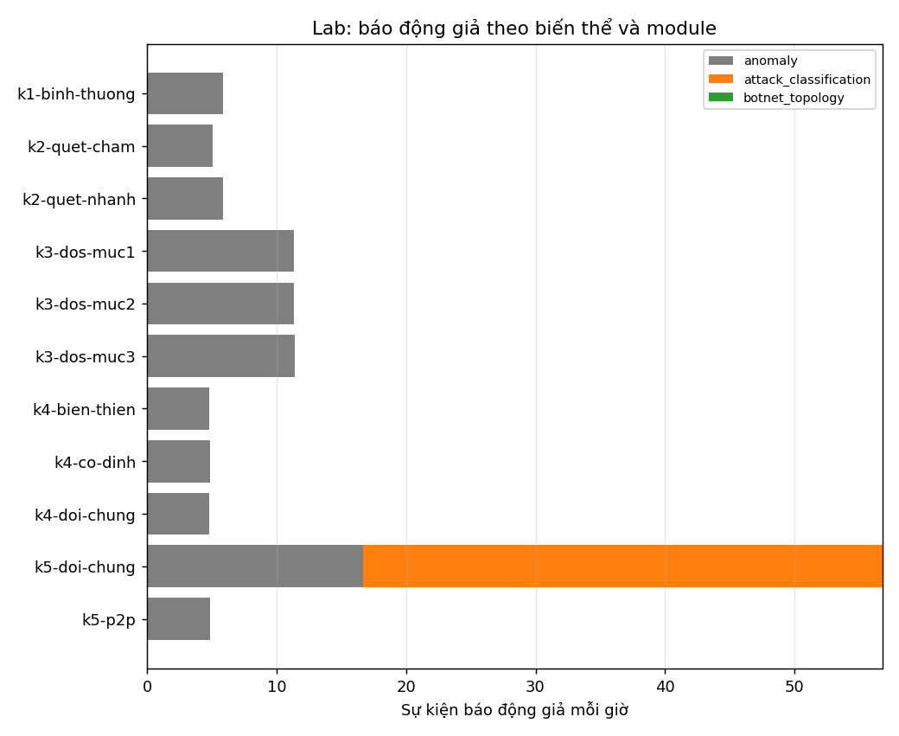

# Báo cáo Chặng 11 — Kiểm thử thực nghiệm

**Đề tài:** Ứng dụng học máy phát hiện tấn công mạng dựa trên dữ liệu lưu lượng mạng

| Mục | Thông tin |
|---|---|
| Kho mã nguồn | https://github.com/nkhhieu123/ml-nids (nhánh `main`) |
| Thời gian | 09/11/2026 – 11/11/2026 |
| Trạng thái | **Xong cả 8 task trên lab ảo** (33 lần chạy `test`). Chưa chạy trên lab vật lý. **Bổ sung 12–13/11/2026:** đã học lại ba module trên dữ liệu lab và chấm trên 33 lần `test` mới: 24/24 đợt, 4 báo động giả (mục 10) |
| Chặng trước | [Bao_cao_Chang_10.md](Bao_cao_Chang_10.md) |

## 1. Tóm tắt

Chặng 11 đo hiệu quả hệ thống bằng kịch bản lab có nhãn chuẩn. Nhóm chưa có 7 máy thật nên lab được dựng
**ảo trên WSL2** bằng network namespace (QĐ-061, [70_lab_ao.md](70_lab_ao.md)): gói tin là gói thật của nhân
Linux, Nginx và Nmap, bắt qua cổng mirror bằng `tcpdump`. Đã thu **33 lần chạy `test`** (11 biến thể × 3 lần,
5,5 giờ traffic, 1,1 triệu gói) kèm nhật ký ground truth, rồi chấm bằng mô hình và ngưỡng đã khóa từ Chặng
6–9, **không chỉnh gì theo dữ liệu lab**.

| Loại | Số đợt | Phát hiện | Bỏ sót | Độ trễ tới cuối cửa sổ | Độ trễ realtime |
|---|---|---|---|---|---|
| Port scan (Nmap chậm, nhanh) | 6 | **6** | 0 | 0,9–2,5 s | 4,3–6,3 s |
| DoS (tải kết nối, 3 mức, 60 s) | 9 | **9** | 0 | 0,4–2,9 s | 3,5–5,9 s |
| Botnet tập trung mô phỏng | 6 | 0 | **6** | — | — |
| Botnet ngang hàng mô phỏng | 3 | 0 | **3** | — | — |
| **Tổng** | **24** | **15 (62,5%)** | **9** | trung vị 1,5 s | trung vị 4,6 s |

- **Port scan và DoS: phát hiện 15/15**, cảnh báo đúng loại được phát sau 3,5–6,3 giây kể từ lúc tấn công bắt đầu.
- **Botnet: bỏ sót 9/9.** Mô hình học từ CTU-13 cho bot của lab điểm cao nhất 0,084, dưới ngưỡng 0,1. Theo
  tiêu chí nghiệm thu, mọi lần không phát hiện đều được tính là bỏ sót.
- **Báo động giả: 64 sự kiện trong 5,49 giờ (11,7 mỗi giờ)**, từ hai nguồn: module anomaly báo máy chủ dịch vụ
  suốt cả bản thu ở cả 33 lần; bộ phân loại báo nhầm `dos` khi các máy chia sẻ khối dữ liệu lớn. Module botnet
  không báo nhầm lần nào (và cũng không báo đúng lần nào).
- **Không mất gói**: 0 gói nhân bỏ, 0 gói hàng đợi bỏ.

## 2. Phương pháp

```bash
sudo bash scripts/chay_chang_11.sh          # thu 33 lần chạy trên 11 lab ảo song song (khoảng 40 phút)
cd src
python -m nids.thuc_nghiem ../data/pcap/lab/k3-*.pcap --net 192.168.50.0/24 --nhat-ky ../data/run_logs \
    --giu ../output/thuc_nghiem_lab --out ../docs/hinh/thuc_nghiem/lab --ten k3        # đo một nhóm
python -m nids.do_tre_realtime ../data/pcap/lab/k3-dos-muc2-test-01.pcap --nhat-ky ../data/run_logs \
    --out ../docs/hinh/thuc_nghiem/lab/realtime                                         # độ trễ realtime
python -m nids.thuc_nghiem_lab ../docs/hinh/thuc_nghiem/lab/k?.json ../docs/hinh/thuc_nghiem/lab/doi_chung.json \
    --nhat-ky ../data/run_logs --out ../docs/hinh/thuc_nghiem/lab                       # tổng hợp và vẽ
```

| Chỉ số | Cách tính |
|---|---|
| Ground truth | Nhật ký lần chạy `data/run_logs/<run_id>.json` do bộ chạy kịch bản ghi; bộ chạy không đọc kết quả mô hình (B10) |
| Phát hiện / bỏ sót | Đợt tấn công có ≥ 1 cảnh báo **đúng loại**, trên host của đợt, trong khoảng thời gian của đợt. Không có = **bỏ sót** |
| Độ trễ tới cuối cửa sổ | Cuối cửa sổ của cảnh báo đầu tiên − thời điểm hành vi bắt đầu. Đã gồm thời gian tích lũy cửa sổ |
| Độ trễ realtime | Phát lại PCAP đúng nhịp lúc bắt qua bộ máy realtime; lấy giờ thật lúc cảnh báo đầu tiên được phát, quy về trục thời gian bản thu, trừ thời điểm hành vi bắt đầu |
| Báo động giả | Sự kiện cảnh báo (đã gộp) không do đợt nào gây ra: khác host, không chồng thời gian, hoặc bắt đầu sớm hơn đầu đợt quá 40 giây (module botnet 150 giây) |
| Hiệu năng | Số gói bắt được và nhân bỏ (tcpdump); thời gian trích xuất và chấm; gói hàng đợi bỏ khi phát lại realtime |

Loại tấn công ↔ module: `dos`, `port_scan` → bộ phân loại; `botnet` → module botnet (`suspect_host`). Cảnh báo
của module anomaly không nêu loại tấn công nên **không** tính là phát hiện; chỉ ghi lại để phân tích.

## 3. Kết quả theo task

Chi tiết từng lần chạy ở [71_ket_qua_lab.md](71_ket_qua_lab.md).

| Task | Biến thể (mỗi cái 3 lần) | Kết quả |
|---|---|---|
| C11-T01 | — | Lab ảo 7 node; máy giám sát thấy 100% kết nối hai chiều; nhật ký ground truth đủ trường của docs/09 |
| C11-T02 | `k1-binh-thuong` | Bộ phân loại và module botnet không báo gì; tác vụ kiểm tra trạng thái định kỳ không bị coi là beaconing. Anomaly báo máy chủ `.30` suốt bản thu |
| C11-T03 | `k2-quet-cham`, `k2-quet-nhanh` | Phát hiện 6/6; cả máy quét lẫn nạn nhân được gán `port_scan` |
| C11-T04 | `k3-dos-muc1/2/3` | Phát hiện 9/9; mỗi đợt đúng 60 giây; dịch vụ không bị ảnh hưởng (client hợp lệ vẫn nhận mã 200) |
| C11-T05 | `k4-co-dinh`, `k4-bien-thien` | Bỏ sót 6/6 ở cả chế độ `ket_hop` và `doc_lap`; điểm bot cao nhất 0,071 |
| C11-T06 | `k5-p2p` | Bỏ sót 3/3; điểm bot cao nhất 0,084; quy tắc `p2p` đòi 5 peer gọi vào, lab chỉ có 3 bot |
| C11-T07 | `k4-doi-chung`, `k5-doi-chung` + lặp lại | Đối chứng tập trung không bị báo nhầm; đối chứng ngang hàng bị báo nhầm `dos` 24 sự kiện. Ba lần lặp của mỗi biến thể cho cùng kết luận |
| C11-T08 | cả 33 lần | Mục 4 |

## 4. C11-T08 — Tổng hợp độ trễ, bỏ sót, báo động giả, hiệu năng

Số liệu: `docs/hinh/thuc_nghiem/lab/tong_hop.json`, `do_tre_realtime.json`.

### 4.1. Độ trễ phát hiện



| Biến thể | Tới cuối cửa sổ (3 lần) | Realtime (3 lần) | Realtime trung vị |
|---|---|---|---|
| `k2-quet-cham` | 1,8 / 2,5 / 1,4 s | 5,1 / 5,6 / 4,6 s | 5,1 s |
| `k2-quet-nhanh` | 1,8 / 0,9 / 1,5 s | 6,3 / 4,3 / 4,6 s | 4,6 s |
| `k3-dos-muc1` | 2,5 / 2,9 / 1,7 s | 5,6 / 5,9 / 4,7 s | 5,6 s |
| `k3-dos-muc2` | 2,2 / 1,0 / 0,6 s | 5,3 / 4,0 / 3,6 s | 4,0 s |
| `k3-dos-muc3` | 1,1 / 1,2 / 0,4 s | 4,2 / 4,2 / 3,5 s | 4,2 s |
| **15 đợt** | 0,4–2,9 s, trung vị 1,5 s | **3,5–6,3 s, trung vị 4,6 s** | |

- **Độ trễ tới cuối cửa sổ nhỏ hơn 3 giây** vì cửa sổ 10 giây trượt mỗi 2 giây: cửa sổ đầu tiên có hành vi kết
  thúc trong vòng 2 giây sau khi hành vi bắt đầu, và bộ phân loại đã báo ngay ở cửa sổ đó dù nó chỉ chứa 0,4–2,9
  giây tấn công.
- **Cảm biến realtime phát cảnh báo muộn hơn cuối cửa sổ 3,0–4,5 giây** (trung vị 3,1): phần lớn là 3 giây chờ
  quan sát bắt tay TCP (`flow.handshake_observe_s`, QĐ-023), còn lại là chờ gói kế tiếp đẩy thời gian và thời
  gian chấm.
- Trên đoạn CIC (mục 5) độ trễ tới cuối cửa sổ là 10–14 giây vì đoạn PCAP bắt đầu khi tấn công đã diễn ra,
  cửa sổ đầu tiên phải đủ 10 giây. Lab cho con số sát thực tế hơn: hành vi bắt đầu giữa bản thu.
- **Botnet không có độ trễ** vì không đợt nào được phát hiện. Nếu phát hiện được, độ trễ sẽ lớn hơn nhiều do
  cửa sổ đồ thị dài 120 giây (trên CIC: 48–78 giây).

### 4.2. Bỏ sót

9/24 đợt bị bỏ sót, **tất cả là botnet**:

| Nguyên nhân | Bằng chứng |
|---|---|
| Mô hình botnet học từ CTU-13 không chuyển sang bot mô phỏng | Điểm bot cao nhất 0,061–0,084 (ngưỡng 0,1); điểm trung vị của bot (0,003) còn thấp hơn máy chỉ duyệt web (0,052). `botnet_diem.json` |
| Ở chế độ `ket_hop`, module botnet chỉ xét host bị anomaly báo (QĐ-047) | Anomaly không báo bot lần nào trong 9 lần: beaconing chậm không làm host bất thường |
| Quy tắc topology `p2p` đòi ≥ 5 peer gọi vào | Lab chỉ có 3 bot |

Chặng 8 đã dự báo điều này trên dữ liệu giả lập (recall 0,017, docs/52). Chặng 11 xác nhận trên gói tin thật.

### 4.3. Báo động giả



| Nguồn | Sự kiện | Ở đâu | Ghi chú |
|---|---|---|---|
| Anomaly trên máy chủ dịch vụ `.30` | 33 | Mọi lần chạy, mỗi lần một sự kiện | Kéo dài **cả bản thu**: thực chất là báo 100% thời gian trên một host |
| Anomaly trên `.41`–`.43` | 7 | `k5-doi-chung` | Lúc truyền khối dữ liệu lớn |
| Bộ phân loại, nhãn `dos` | 24 | `k5-doi-chung` (10 / 5 / 9) | Chia sẻ dữ liệu ngang hàng lành tính bị coi là DoS |
| Module botnet | 0 | — | Không báo gì trên lab |
| **Tổng** | **64** | 5,49 giờ | **11,7 sự kiện mỗi giờ** |

- Ngoài `k5-doi-chung`, **bộ phân loại không có báo động giả nào** trong 30 lần chạy còn lại, kể cả trên
  traffic bình thường và trên đối chứng tập trung.
- Số "sự kiện mỗi giờ" của anomaly đánh giá thấp vấn đề: một sự kiện kéo dài cả bản thu. Gaussian học bình
  thường từ CIC-IDS2017 không mô tả được máy chủ của lab (đúng thiếu hụt đã nêu ở docs/09).

### 4.4. Hiệu năng

| Chỉ số | Giá trị |
|---|---|
| Gói bắt được (33 lần) | 1 107 043 |
| Gói nhân bỏ khi bắt (tcpdump) | **0** ở cả 33 lần |
| Thời lượng bản thu | 19 752 giây (5,49 giờ) |
| Thời gian xử lý offline (trích xuất + chấm) | 70,0 giây, tức nhanh hơn thời gian thật khoảng 280 lần |
| Lần nặng nhất (`k3-dos-muc3`, 173 nghìn gói trong 5 phút) | Trích xuất 8,1–9,0 giây (khoảng 20 nghìn gói mỗi giây); chấm ba module dưới 0,3 giây |
| Phát lại realtime đúng nhịp (15 lần có tấn công) | 0 gói hàng đợi bỏ; 15/15 đợt được phát hiện như khi chạy offline |

Trích xuất đặc trưng vẫn là phần tốn thời gian nhất (docs/54), nhưng ở tải của lab còn dư rất xa.

## 5. Đối chiếu với đoạn CIC-IDS2017 (đo ngày 09/11, chạy lại 11/11)

Trước khi có lab, bộ đo được chạy thử trên 4 đoạn test của Chặng 9 (`docs/hinh/thuc_nghiem/thuc_nghiem.json`):

| Đoạn | Đợt tấn công | Phát hiện | Độ trễ tới cuối cửa sổ | Báo động giả (botnet / anomaly) |
|---|---|---|---|---|
| `wed_slowloris` | dos | ✓ | 10 s | 7 (4 / 3) → 75 mỗi giờ |
| `wed_hulk` | dos | ✓ | 14 s | 16 (8 / 8) → 280 mỗi giờ |
| `fri_quet` | port_scan; botnet (ARES) | ✓; ✓ | 10 s; 48 s | 11 (4 / 7) → 31 mỗi giờ |
| `fri_binh_thuong` | botnet (ARES) | ✓ | 78 s | 3 (2 / 1) → 8,9 mỗi giờ |

So với lab: trên CIC module botnet phát hiện được bot ARES nhưng báo nhầm nhiều; trên lab nó im lặng hoàn toàn.
Cả hai đều cho thấy mô hình botnet học từ CTU-13 **chưa đáng tin trên mạng khác**.

## 6. Giới hạn

1. **Lab ảo, không phải lab vật lý**: đường truyền không trễ, không mất gói; mọi máy chung đồng hồ nên độ lệch
   đồng hồ bằng 0; máy giám sát là namespace Ubuntu trên WSL2, không phải Kali. Số gói nhân bỏ và độ trễ chưa
   phản ánh card mạng và switch thật.
2. **Chỉ có lần chạy `test`** (33/55 lần của docs/09). Chưa thu `train`, `val`, nên chưa học lại mô hình nào
   trên dữ liệu lab.
3. **Tải kết nối không làm chậm dịch vụ** trên lab ảo, kể cả mức 600 kết nối mỗi giây; chưa đo được ảnh hưởng
   của DoS lên dịch vụ (B16).
4. **Độ trễ realtime đo bằng phát lại PCAP** trên laptop Windows, chưa đo với cảm biến bắt trực tiếp.
5. **Máy tấn công `.20` không có traffic bình thường xen kẽ**, nên phát hiện sớm dễ hơn thực tế.
6. Mỗi biến thể chỉ có 3 lần; đủ để thấy kết quả nhất quán, chưa đủ để ước lượng tỷ lệ với khoảng tin cậy hẹp.

## 7. Việc tiếp theo

1. Thu lần `train` và `val` (`bash scripts/chay_chang_11.sh train 1`, `val 1`), rồi: fit lại Gaussian trên
   kịch bản 1; thêm mẫu chia sẻ dữ liệu lành tính vào train của bộ phân loại; học lại module botnet trên kịch
   bản 4, 5.
2. Xét lại việc module botnet phụ thuộc anomaly ở chế độ `ket_hop` (QĐ-047) và ngưỡng số peer của quy tắc
   `p2p`, chọn trên `val`.
3. Sau khi khóa lại mô hình, thu **lần `test` mới** để báo cáo (các lần `test` hiện tại đã được xem kết quả).
4. Khi có máy thật: chạy lại trên lab vật lý với Kali, đo gói nhân bỏ và độ lệch đồng hồ.

Danh sách đầy đủ ở [Viec_con_thieu.md](Viec_con_thieu.md) mục 4g.

## 8. Sản phẩm

| Sản phẩm | Vị trí |
|---|---|
| Lab ảo và bộ chạy kịch bản | `scripts/lab_ao.py`, `scripts/chay_chang_11.sh` ([70_lab_ao.md](70_lab_ao.md)) |
| Bộ đo | `src/nids/thuc_nghiem.py`, `src/nids/do_tre_realtime.py`, `src/nids/thuc_nghiem_lab.py` |
| PCAP (33 file, 181 MB) | `data/pcap/lab/` — không lên git; SHA-256 trong nhật ký |
| Nhật ký ground truth (33 file) | `data/run_logs/<run_id>.json` |
| Access log Nginx | `data/service_logs/<run_id>/` — không lên git; số đối chiếu ở `access_log.json` |
| Cảnh báo, sự kiện từng lần | `output/thuc_nghiem_lab/` — không lên git |
| Số liệu | `docs/hinh/thuc_nghiem/lab/*.json`, `realtime/*.json` |
| Ảnh | `docs/hinh/thuc_nghiem/lab/lab_do_tre.png`, `lab_bao_gia.png` |
| Kết quả chi tiết | [71_ket_qua_lab.md](71_ket_qua_lab.md) |

## 9. Kiểm thử

`python -m unittest discover -s tests`: **426/426 ca đạt** (Chặng 10 kết thúc ở 408).

- `tests/test_thuc_nghiem.py` (11 ca): ánh xạ lịch nhãn và nhật ký lần chạy sang đợt tấn công; đối chứng lành
  tính không thành đợt; độ trễ và bỏ sót (sai host, sai nhãn không tính); cảnh báo trên máy điều khiển không
  tính là phát hiện; sự kiện bắt đầu từ lâu trước đợt vẫn là báo động giả; anomaly ghi riêng.
- `tests/test_thuc_nghiem_lab.py` (5 ca): gộp theo biến thể, lần không phát hiện tính là bỏ sót, báo động giả
  mỗi giờ; quy giờ phát cảnh báo realtime về trục thời gian bản thu.

## 10. Bổ sung sau báo cáo (12–13/11/2026)

Các mục 1–9 mô tả mô hình học từ CIC-IDS2017 và CTU-13, chấm trên 33 lần `test` đầu tiên. Sau đó đã làm thêm:

| Việc | Kết quả | Tài liệu |
|---|---|---|
| Thu đủ `train`, `val` (22 lần) và học lại ba module trên lab | Trên 33 lần `test` mới (lần 4–6): **24/24 đợt** (mô hình cũ 15/24), báo động giả **63 → 4** sự kiện, macro-F1 theo cửa sổ 0,923 → 0,995; test CIC của bộ phân loại không đổi | [73_hoc_lai_lab.md](73_hoc_lai_lab.md), QĐ-068 |
| Cảm biến realtime bắt trực tiếp trên máy giám sát | Không bỏ gói; độ trễ thật 3,9–4,2 giây (quét, DoS), 18–30 giây (botnet) | [74_thi_nghiem_bo_sung.md](74_thi_nghiem_bo_sung.md) mục 1 |
| Máy tấn công có traffic bình thường xen kẽ | Vẫn phát hiện 5/5 đợt | 74 mục 2 |
| Chế độ pipeline và khoảng gộp sự kiện trên lab | Lab dùng `doc_lap`; khoảng gộp 10–120 giây cho cùng số sự kiện | 74 mục 3 |
| Bộ phân loại theo cửa sổ host; máy tấn công là host thật | Macro-F1 0,923 trên lab với mô hình cũ | [71_ket_qua_lab.md](71_ket_qua_lab.md) mục 7 |
| Khóa tham số và quyết định tạm thời | QĐ-062 tới QĐ-067 | [72_do_nhay_tham_so.md](72_do_nhay_tham_so.md), docs/03 |
| Access log, ghép log–flow, đối chiếu Wireshark trên lab | Đọc 100% log, ghép 100% dòng, lệch 0 với Wireshark | docs/16 mục 5–6, docs/17 mục 3.2 |

Giới hạn chính của kết quả học lại: `train`, `val`, `test` cùng một lab ảo và cùng bộ sinh traffic, nên chưa chứng
minh mô hình nhận ra botnet thật hay mạng khác. Việc còn lại ở [Viec_con_thieu.md](Viec_con_thieu.md).

## Thuật ngữ

Giải thích ngắn các thuật ngữ dùng trong tài liệu này.

| Thuật ngữ | Giải thích |
|---|---|
| Ground truth | Sự thật đã biết trước (đợt tấn công nào, host nào, lúc nào) để chấm điểm phát hiện |
| Lab ảo | Mạng thử nghiệm dựng bằng network namespace trên một máy Linux thay cho 7 máy thật |
| Đợt tấn công | Một hành vi tấn công của một lần chạy, trên các host và khoảng thời gian ghi trong nhật ký |
| Độ trễ phát hiện | Thời gian từ lúc tấn công bắt đầu tới lúc có cảnh báo đầu tiên |
| Thời gian tích lũy cửa sổ | Thời gian phải chờ cho cửa sổ đủ dữ liệu trước khi chấm được |
| Độ trễ realtime | Độ trễ tính tới lúc cảm biến realtime thật sự phát cảnh báo, gồm cả thời gian chờ và xử lý |
| Bỏ sót | Tấn công có thật nhưng không có cảnh báo đúng loại nào |
| Báo động giả | Cảnh báo không do đợt tấn công nào gây ra |
| Sự kiện | Nhiều cảnh báo liên tiếp cùng module, nhãn, host được gộp làm một |
| Đối chứng | Lưu lượng lành tính có hình dạng giống tấn công, để kiểm tra mô hình không báo nhầm |
| Nhật ký lần chạy | File ghi mỗi lần thử trong lab, dùng làm ground truth, độc lập với dự đoán |
| Chế độ `ket_hop` / `doc_lap` | `ket_hop`: bộ phân loại chấm mọi cửa sổ, module botnet chỉ xét host bị anomaly báo. `doc_lap`: ba module chấm độc lập |
| Phát lại PCAP | Đưa các gói đã bắt vào chương trình theo đúng nhịp thời gian lúc bắt |
| Gói nhân bỏ | Gói mà nhân hệ điều hành không kịp đưa cho chương trình bắt gói |
| Bot ARES | Botnet trong traffic thứ Sáu của CIC-IDS2017 |
| Beaconing | Bot gọi về máy điều khiển theo chu kỳ |
| Train / val / test | Lần chạy để học / để chọn tham số và ngưỡng / để đánh giá cuối |
